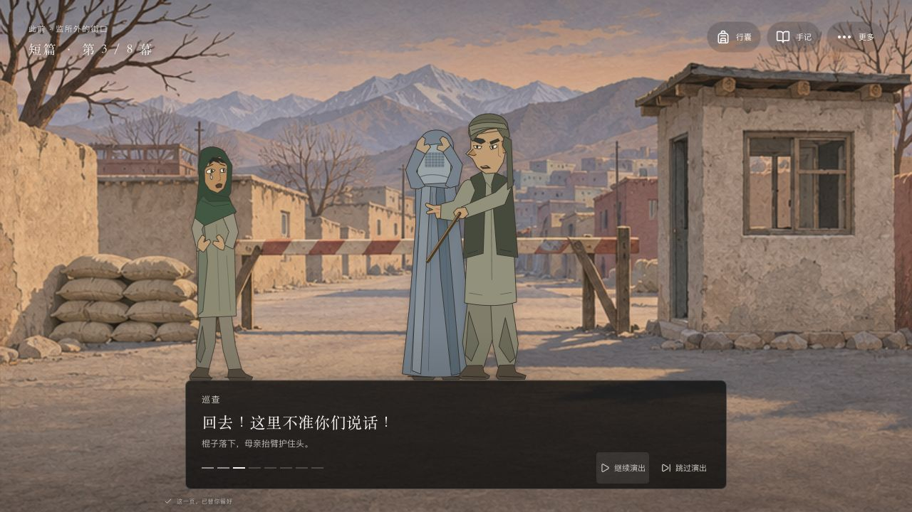
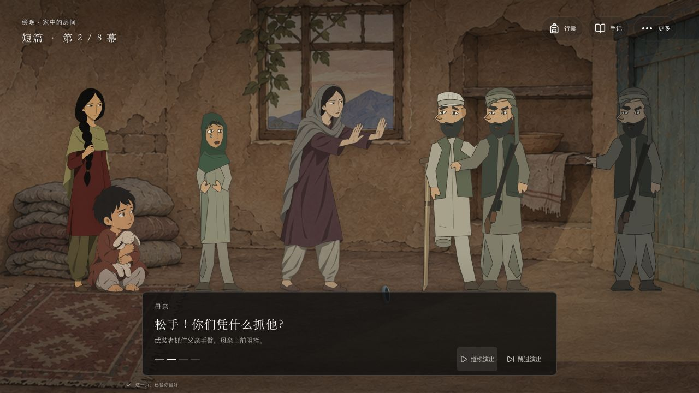
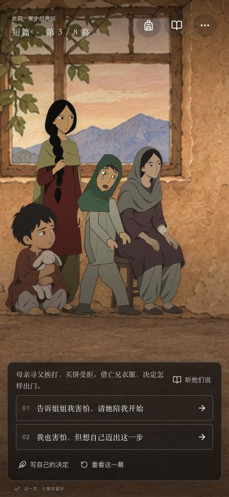

# 姐姐，我该怎么走

> 家里叫我努拉。走到街上，我叫阿提什——火焰。

一款以姐妹关系、家庭生计与寻找被捕父亲为主线的中文互动叙事小游戏。

十二岁的努拉和父亲坐在市场的旧毯上，替人读信，卖一点家中旧物。年轻武装巡查的报复把父亲从全家眼前带走。母亲要求放人，却在路上挨打；买食物的女孩也被拒绝和追赶。努拉剪下头发，穿上亡兄的衣服，与同样女扮男装的旧同学一起赚钱、打听消息，反复走近监所的门。

玩家选择怎样挣钱、照护、求助和兑现约定，也可以打字表达当下的决定。姐姐会拒绝、争执、受伤、离开和重逢；故事的变化同时体现在人物、衣着、位置与场景里。

以 **Next.js + React + TypeScript + GSAP** 实现。默认是一局 **8 次关键决定的短篇**，保留 **5 种结局**；原 30 节点、85 行动的完整篇仍兼容旧进度。其中 **3 种属于现实分支，2 种是明确标示的愿望梦境**。默认无需模型账户或 API Key。



## 开始运行

### 新电脑安装

需要 **Node.js 22.12 或更新版本、npm 和 Git**。Node.js 安装包通常包含 npm，可先用以下命令确认：

```sh
node --version
npm --version
git --version
```

克隆并安装锁定版本的依赖：

```sh
git clone https://github.com/xypasolini-droid/sister-which-way.git
cd sister-which-way
npm ci
npm run dev
```

在浏览器打开 **http://127.0.0.1:3000**。运行期间保留终端窗口，按 `Ctrl+C` 停止服务。首次安装依赖需要网络；默认剧情与美术随项目提供，游玩不需要调用外部模型。

如果下载的是仓库 ZIP，先解压，在含有 `package.json` 的目录打开终端，再执行 `npm ci` 和 `npm run dev`。

### macOS 快捷启动

完成一次 `npm ci` 后，可以双击仓库中的 **`启动游戏.command`**。这个脚本只启动本地服务，不会替你安装 Node.js、下载依赖或填写模型密钥。若系统未直接打开脚本，使用上面的终端命令即可。

### 端口与生产构建

若 3000 端口已被占用：

```sh
npm run dev -- --port 3001
```

然后打开 http://127.0.0.1:3001 。不同端口属于不同浏览器存储来源，不会共享当前进度。

本地检查生产构建：

```sh
npm run build
npm start
```

`npm start` 同样使用 127.0.0.1:3000。需要换端口时运行 `npm start -- --port 3001`。当前仓库提供本地运行方式，尚未提供公开在线试玩地址。

## 怎么玩

| 操作 | 用途 |
| --- | --- |
| 点当前行动，或选择路线、回应人物 | 单选即执行对应行动并推进剧情，无需整理物件、配衣服或做算术 |
| 分镜中的暂停／继续、跳过、重看 | 控制冲突演出；不会代选行动、改变物资或增加决定次数 |
| **听他们说**、继续、空格或右箭头 | 随时听短对白，没有倒计时或自动替选 |
| 点击行动；传统选择列表中也可按 `1`、`2`、`3` | 做出当前场景中的决定 |
| 传统选择列表中的 **先想一想** | 展开选项的完整说明与未满足条件 |
| **写自己的决定** | 用自己的说法表达行动；`Command/Ctrl+Enter` 提交，`Enter` 换行 |
| **行囊** | 查看家人、物资、约定和最近发生的变化 |
| **手记** | 阅读完整场景与选择后果，回看童话、收藏结局，导出 Markdown |
| **更多 → 回到上一个决定** | 撤回到对应的剧情、人物和资源状态 |
| **静静看一会儿** | 暂时收起叙事界面，观看彩色场景 |
| **更多**中的显示设置 | 使用较大文字、减少画面运动或进入全屏 |

每场直接从现有行动中单选一条路，选下便推进。装包、整理衣物和算术小游戏已取消，也没有额外的“选择下一步”或最终确认层。赶摊、父亲被捕、母亲遭打、女孩被拒售并逼回家等冲突用短分镜自动呈现，可以暂停、跳过或重看；演出不会替玩家作决定。其他对白可随时打开，关键童话仍用 2–3 句切到独立画面，长篇正文与细节留在手记中。中文输入法确认候选词不会被当作提交决定。

**短篇每局固定 8 次决定**：摆摊 → 被捕后的约定 → 变装 → 遇见同学 → 谋生或交涉 → 决定最后方向 → 救父／接应／留下 → 写下结尾。不同选择改变中段场景、家人关系和结局，不要求反复查证、跑腿、收集所有热点。最终选择后立即显示结局与简短结果。

旧版完整篇的三十个节点是整张分支图，不是每局必须经历的三十步。旧存档可继续；在“更多 → 重新开始 · 8 幕短篇”会开新短篇，并保留结局收藏。食物、零钱、姐妹信任、被注意程度和家人身体会改变后续可走的路；受到限制的选项会说明原因。可以重读、撤回或重新开始，不需要靠快速点击抢时间。

**打字的范围是已有行动。** 输入会匹配当前节点中已编写且可执行的选项；它不能任意生成新剧情、让角色凭空复活或改写整张地图。提问、否定、互相冲突或超出范围的表达会得到提示，不会自动替你选择。

作坊里可以选择带自己的报酬回家，或征求女工同意后保留被扣工钱的记录；路线、姐妹回应与最后的去向也都直接单选，不要求先完成准备任务。“听他们说”“写自己的决定”和终章梦境入口继续保留。

演出只是表现当前处境，反复观看不能刷取资源。所有真实行动仍由 `choose` 检查当前节点、锁定条件、资源与后果，已经执行的剧情按存档恢复。当前视觉方向、分镜顺序和规则边界见 [单选分路与冲突分镜设计](docs/design/OPPRESSION-DESIGN.md)；实际试玩与未验证范围见 [可玩性验收](docs/design/PLAY-QA.md)。

## 画面里的变化

父女开场有专门的坐姿与摆摊动作。巡查走到摊前威胁，随后在家中带人抓住父亲、拖向门口，最后留下空位。短篇变装前，分镜依次呈现母亲被拦、求问、挨打、女孩扶她离开，再到摊主拒售、巡查举棍和女孩空手回家；地点会随事件改变。减少运动模式仍保留各拍姿态、字幕与在场事实。



服装与身体状态由剧情决定：女孩头巾、剪发后的小帽与男装、旅途行囊、姐姐在家与公开场合的不同衣着、母亲养伤、姐姐脚踝受伤，以及获救父亲虚弱地靠在木推车上，都有独立素材。主角、姐姐、母亲、父亲、幼弟萨米、同学莱拉与看守阿明按具体场面出现，不是每次转场都跟随同一支队伍。

本轮新增的巡查、摊主、远亲及受伤、扶人、害怕等表情姿态为项目自制的可编辑 SVG，位于 `public/art/oppression/`，与已有彩色素材一起组成舞台。它们不是电影帧裁切，也不声称逐帧复刻或获得真人历史学者认证。施压者通过具体身份与行动出现，不能将其泛化为整个伊斯兰文化的共同面貌。

人物使用持续保留的舞台槽位；普通切句和进入选择不会重播整组入场，也不会突然换人物大小。抓捕、换装和真正的进出场仍有实际变化。

彩色人物与纸片质感场景占据主画面，黑白半透明磨砂界面承载必要对白和操作。手机使用独立构图与纵向选项；说话人通过明暗突出，不把其他人物处理成透出背景的半透明剪影。

<p align="center">
  
</p>

## 现实、童话与梦境

现实层中的勇敢不会取消代价。男孩伪装为努拉打开有限的劳动空间，也会遇到被认出、剥削、武装胁迫和战争。母亲与姐姐不能因为换上外罩，就自由走过公开街道；司机、陌生人和一张纸也不能代替被要求的亲属陪同。

“火苗走过的路”是本作原创的连续童话。在照顾萨米、和莱拉续讲、监所等待等关键场景中，现实舞台会切到红金色纸片森林。故事给人安慰和想象，不会消除真实的伤势，也不直接决定父亲是否获救。

终章的 **“做一个梦”** 提供两个独立入口：

- **守护之地**：成年的阿提什带领全女性卫队，守护女性能够上学、经商和决定生活的自治土地。
- **没有锁的明天**：成年后的她、姐姐与莱拉建立学校、市场和女性议事庭，共同决定这里的生活与进入规则。

两者都有明确的梦境标识，使用成人角色和独立城市。现实里的父亲、家人伤势、物资与姐妹关系不会被梦修改；撤回仍回到原来的现实状态。

现实的三种结局围绕女主成长：**这次，我带你回家**、**这条路，我自己选**、**我不再一个人养家**。写信、等待、分住、借住和见证保留为前情与尾声差异，不再单独计数。前面完成的救父、登车等结果决定现实结局；两个成年梦境分别回应守护与建设。

## 电影依据与原创范围

本作参考 **Nora Twomey 执导的 2017 年动画电影《养家之人 / The Breadwinner》**。它是原创分支游戏，不是电影授权改编或逐镜头复刻，也没有把小说中的情节自动当作电影内容。

| 层次 | 本项目如何使用 |
| --- | --- |
| 电影主干 | 父女摆摊、报复抓捕、母亲寻父遭打、女孩购食受拒、剪发穿亡兄衣服、同为男装的同学、反复探监、看守的个人冒险救援，以及母亲反抗强迫带离 |
| 电影中的具体因果 | 母亲主动写信提出姐姐的婚事，以求远亲照应；后来拒绝丢下尚未归家的女儿。取名“阿提什”的火焰含义也有课程材料依据 |
| 历史处境 | 核对 2001 年前后阿富汗的女性出行限制、衣着、私人诊疗和战争风险，限定到具体政权与时期，不概括整个伊斯兰世界 |
| 游戏原创 | 努拉、玛莉安等姓名与年龄、虚构山城萨岚、压缩的“第几日”、具体资源与数值、部分文书和名册支线、30 节点的分岔、火苗童话、三个现实结局及两个成年梦境 |

电影片尾保留开放性：父女与母亲、姐姐、幼弟分别艰难前行，朝着会合方向走去。游戏中的“这次，我带你回家”等明确团聚结果属于本作扩写，不声称电影已经演出了全家安全离境。

游戏里取得姓名、编号或文书的部分过程是原创支线，不应当作电影已有镜头或正常司法放人的程序；五日左右的章节时间也不是对影片真实时程的复刻。现实路线采用邻居明确邀请的一夜私宅借住与遮挡后的女医师诊疗，没有把制度性救济点当作剧情解答。

主要来源：

- [GKIDS 官方影片介绍](https://gkids.com/films/the-breadwinner/)：影片背景、女孩承担生计与故事主题。
- [CNC 官方教师资料入口](https://www.cnc.fr/cinema/education-a-l-image/college-au-cinema/dossiers-pedagogiques/dossiers-maitre/parvana-de-nora-twomey_1498891)及[同版教师册 PDF](https://mediatarn.org/wp-content/uploads/2023/07/dossier-enseignants-Parvana-de-Nora-Twomey.pdf)：人物关系、分场顺序、改编与 Aatish 的名字。
- [Le Pacte 官方 press kit](https://le-pacte.com/storage/uploads/edc4e180-ec46-4379-9268-d7c37c0a2c81/DP-web-PARVANA.pdf)：剧情简介、导演访谈与开放结局。
- [Human Rights Watch 2001 年报告，第 VI 节](https://www.hrw.org/reports/2001/afghan3/afgwrd1001-05.htm)：当时女性外出、服饰限制与暴力的访谈记录。

完整依据、局部影片观察、可确认内容和未核实部分分别见 [影片内容核查](docs/design/FILM-CONTENT-REVIEW.md)、[历史文化核查](docs/design/HISTORICAL-CULTURAL-REVIEW.md)、[本地影片抽样审计](docs/design/LOCAL-FILM-AUDIT.md)与[场景因果审计](docs/design/CAUSALITY-REVIEW.md)。这些是有来源的研究记录，不是逐帧看完整部电影或真人历史学者认证的声明。

## 存档与隐私

默认进度、结局册、对话位置和显示偏好保存在当前浏览器的 `localStorage` 中。当前首页没有账号系统、云端存档或多人同步。浏览器清理数据、更换浏览器、无痕窗口、切换域名或端口，都可能让你无法继续原来的进度。

- **重新开始**会开一局新故事，保留已见过的结局。
- **回到上一个决定**恢复对应的故事状态；结局册保存该结局最近一次到达时的实际家人状态。
- **导出 Markdown**得到可阅读的故事记录，目前不能把 Markdown 再导入为存档。
- 内部故事版本为 v3；新增 `edition: short` 区分八幕短篇与旧完整篇，验证时按相应规则重放，不会把旧路线当作新路线。旧 v2 记录不会被删除或强行解释成新结构。存档通过重放合法行动验证；只有曾停在旧 v3 抓捕入场处的快照有明确、有限的兼容处理。

没有配置模型时，打字匹配在浏览器的本地规则中进行，不发送给模型提供商。页面会向同一应用的 `/api/decision` 查询是否配置了可选服务，该查询本身不调用模型。

### 可选：使用模型理解更多说法

无需配置即可完整游玩。若希望模型协助识别已有选项的不同表述，在项目根目录把 `.env.example` 复制为 `.env.local`，填入服务端配置：

```dotenv
LLM_API_KEY=你的服务端密钥
LLM_BASE_URL=https://api.openai.com/v1
LLM_MODEL=你的模型ID
```

提供商需要兼容 OpenAI 风格的聊天接口，并支持这里使用的结构化输出。只有同时填写 `LLM_API_KEY` 与 `LLM_MODEL` 并重启服务器，才会启用；省略 `LLM_BASE_URL` 时使用上面的地址。

启用后的数据路径：

1. 浏览器仍先尝试本地规则。不能明确匹配时，才把当前故事状态和玩家输入发给本项目的服务端。
2. 服务端重放并验证状态，再把**当前场景正文、当前可执行选项和玩家输入**发给所配置的模型提供商，使用该账户的额度。
3. 返回值只能是当前可执行选项的 ID 或不匹配提示；不能直接改状态、执行代码或创造新行动。连接或解析失败时仍可使用本地选项。

密钥只放在服务端 `.env.local`，不要写入浏览器代码；该文件已被 `.gitignore` 排除。配置第三方服务后，其收费与数据处理规则由所选提供商决定。本项目尚未实现公开服务所需的用户认证、账户配额或完整运营后台。

## 技术与主要文件

当前首页使用 Next.js App Router、React、TypeScript 和 DOM 图层舞台；GSAP 负责克制的位移、换景与事件动画，Vitest 验证规则，AI SDK 和 Zod 支持可选意图解释。依赖中仍包含早期原型使用的 PixiJS，当前主舞台不依赖它绘制人物。

```text
src/app/page.tsx                    当前首页入口
src/components/SisterGame.tsx       对话、选择、输入、存档、撤回、手记与结局册
src/components/NarrativeStage.tsx   常驻人物与物件、换景、四拍抓捕事件
src/components/SceneEncounter.tsx   直接单选故事路径与可选对白
src/components/OppressionSequence.tsx  冲突分镜及暂停、跳过与重看
src/components/narrative-stage.css  舞台比例、手机构图与减少运动
src/app/globals.css                 界面、磨砂面板、对话与弹窗样式
src/lib/branch-story.ts             完整篇规则、5 结局与按版本重放存档
src/lib/short-story.ts              默认短篇：8 次决定的节点与后果
src/lib/scene-encounter.ts          场景目标、短回应与合法行动映射
src/lib/play-flow.ts                阅读、场景操作、选择及结尾阶段
src/lib/scene-dialogue.ts           每场 2–4 句对白与入口条件
src/lib/story-presentation.ts       对话节拍、童话片段、简短结尾与称呼
src/lib/ending-content.ts           五种成长结局及按家人状态调整的正文
src/lib/ending-presentation.ts      主屏成长主题与真实行动的结尾回声
src/lib/narrative-stage-state.ts    具体在场人物、衣着、伤姿与场景映射
src/lib/decision-mode.ts            可选模型配置探测
src/app/api/decision/route.ts       服务端意图匹配，限制为当前已有选项
src/lib/*.test.ts                   路线、状态、存档、对白与舞台映射测试
src/components/NarrativeStage.test.ts  场景播报回归测试
public/art/sister/                  彩色背景与剧情道具
public/art/sister-v2/               人物变体、摆摊坐姿、童话与梦境素材
public/art/oppression/             施压者与受伤姿态、父亲拐杖和推车、车辆及两种成人梦境 SVG
docs/story/                        完整剧情、路线与设计说明
docs/design/                       研究、因果审计、设计与验收记录
docs/images/                       当前游戏界面截图
```

早期的 `src/lib/story.ts`、`StoryStage.tsx` 与 `/api/rewrite` 仍保留在源码中；当前首页使用上表的分支系统，旧原型并不是另一个默认游玩入口。

调整剧情时，建议同时检查节点正文、行动后果、短对白和舞台在场规则。新增一条边，除了“能走过去”，还应确认角色在下一场知道什么、谁真正到场、受伤是否仍需照护。

## 检查与验收范围

```sh
npm test
npm run typecheck
npm run build
```

测试涵盖三十节点与五结局的合法可达性、资源条件、存档重放、打字歧义、家人状态、换装、受伤延续、场景播报、短对白长度，以及梦境不改变现实状态。新版短篇与场景操作的验证见 [可玩性验收](docs/design/PLAY-QA.md)，使用的技能与 GitHub 工具依据见 [设计约定](docs/design/PLAY-DESIGN.md)与[改进记录](REVISION_HISTORY.md)。此前版本的测试数量、生产版完整路线与桌面／手机走查结果见 [发布前验收](docs/design/PUBLICATION-QA.md)；较早的界面改版记录见 [沉浸界面验收](docs/design/IMMERSION-QA.md)。

浏览器手机视口检查不等于所有实体手机、多浏览器和屏幕阅读器都已验证；可选付费模型的真实调用也应按具体提供商另行测试。这里不宣称已经人工走完全部 85 个行动或不存在任何问题。

开发内容可从 [故事设计](docs/story/STORY-DESIGN.md)、[完整剧情与路线示例](docs/story/STORY-CONTENT.md)、[场景因果审计](docs/design/CAUSALITY-REVIEW.md)开始阅读。

## 美术、素材与许可

人物、背景、剧情物件与梦境图是为本项目生成并整理的游戏插画，采用参考后的重新绘制，不是把电影帧裁切成游戏贴图。生成方式、提示词和素材说明见 [美术目录说明](public/art/README.md)、[背景与道具](public/art/sister/README.md)和[新版角色说明](public/art/sister-v2/README.md)。

用户提供的电影只在本机作为局部观看、抽样与研究参考。仓库不包含电影视频、电影音轨或电影截图；上方 README 图片是本游戏的运行截图。电影名称、角色及原作品的权利不因本项目的研究或再创作而转移，也不表示获得片方授权。

**目前没有为整个项目提供统一的 `LICENSE` 文件，也未将本项目声明为 MIT 授权。** 第三方依赖分别遵循其自身许可证；不能从依赖许可推断新增代码、文字或生成美术适用同一许可。需要复用或再发布时，请先确认相关部分的授权范围。

## 本轮流程与故事审查

已按八次决定、五种成长重新梳理[完整流程图](docs/design/STORY-FLOW.md)，并完成[游戏设计审查](docs/design/ENDING-GAME-DESIGN-REVIEW.md)、[小说结构审查](docs/design/ENDING-NOVELIST-REVIEW.md)及[影片细节审计](docs/design/DETAIL-AUDIT.md)。[导演与编剧的公开创作资料](docs/design/CREATOR-INFORMED-REVISION.md)用于本作原创调整，不表示创作者本人参与、授权或认可。
