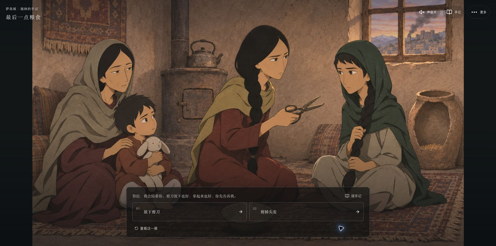
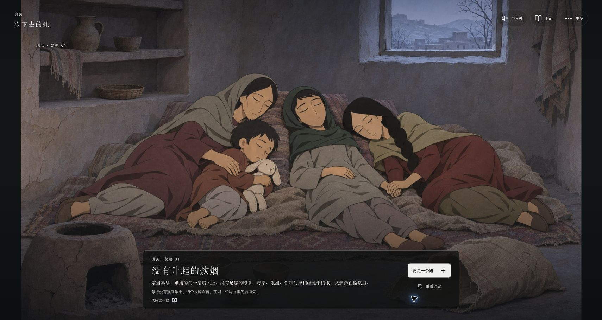
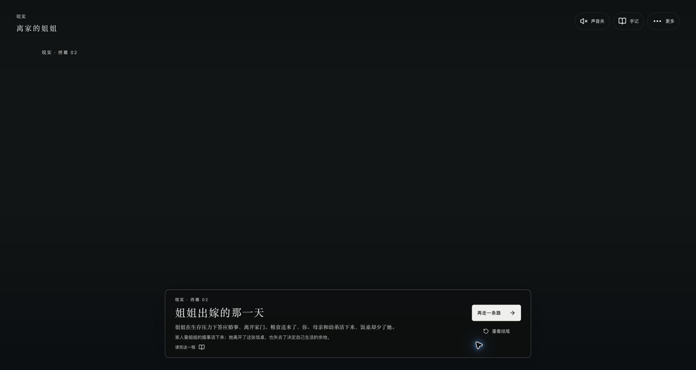
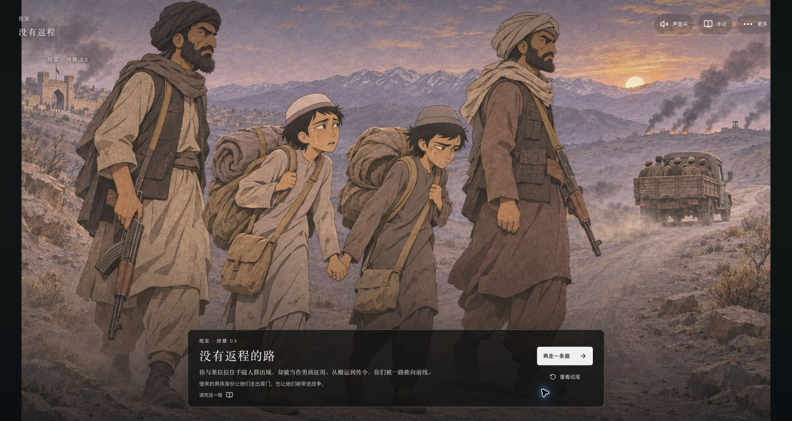
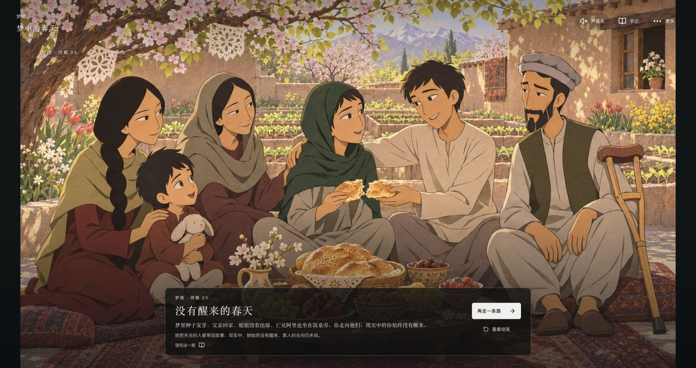
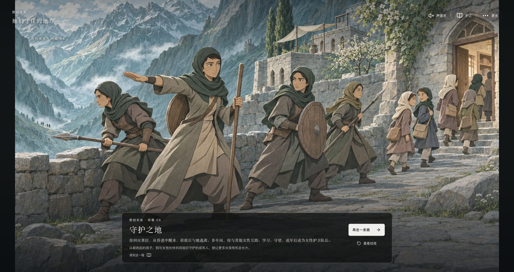

# 姐姐，我该怎么走

> 家里叫我努拉。走到街上，我叫阿提什——火焰。

以《养家之人》的处境与种子童话为参考，创作的一款中文互动叙事小游戏。**0.6.0 从最后一点粮食、姐姐手里的剪刀开场**：父亲已经当着全家人的面被捕，母亲、姐姐、努拉与幼弟失去收入。留下等待，还是借男孩的身份出门？每一个选择都改变下一条路。

全图只有 **4 处分叉、9 个选项、6 条完整路线**。一局做 **2–3 次关键选择**，其他情节以可暂停、跳过和重看的短镜头连续演出。选择一次就进入后续情节，最后一次选择先呈现结果，再显示终幕。没有自由输入、整理衣物、工钱核算、隐藏数值门槛或随机结局。

彩色手绘场景搭配黑白半透明磨砂界面。主画面每镜保留一到两句短字幕，完整叙事放在手记里。声音默认关闭；玩家可主动开启本地合成音效，不影响字幕与选择。剧情包含饥饿、强迫婚姻、儿童被征用与暴力，画面避免血腥特写。



## 运行与试玩

**[直接打开0.6.0游戏](https://xypasolini-droid.github.io/sister-which-way/)**，无需安装或配置模型账户。公开试玩页使用与小红书ZIP相同的静态产物；进度保存在当前浏览器，不同设备和网址之间不会自动同步。

下载发布包：[0.6.0小红书离线ZIP](https://github.com/xypasolini-droid/sister-which-way/releases/tag/v0.6.0)（8.08 MB），或查看[完整验收记录](docs/design/QA-v060.md)。

也可下载源码，在本机运行：

```sh
git clone https://github.com/xypasolini-droid/sister-which-way.git
cd sister-which-way
npm ci
npm run dev
```

需要 Node.js 22.12 或更新版本。打开 [http://127.0.0.1:3000](http://127.0.0.1:3000)，运行期间保留终端窗口。首次安装需要网络，默认游玩不需要模型账户、API Key 或外部服务。macOS 完成安装后也可双击 `启动游戏.command`。

生产构建与另一个端口：

```sh
npm run build
npm start -- --port 3001
```

打开 [http://127.0.0.1:3001](http://127.0.0.1:3001)。不同端口的浏览器存储彼此独立。

## 六条命运（含剧透）

| 编号与终幕 | 选择路线 | 命运与最后画面 |
| --- | --- | --- |
| **01 没有升起的炊烟** | 放下剪刀 → 拒绝婚事、继续等待援助 | 求援接连失败，家当卖尽。留在家的母亲、姐姐、努拉与幼弟相继饿死；冷灶、空碗与安静的房间。父亲不在家中。 |
| **02 姐姐出嫁的那一天** | 放下剪刀 → 和家人一起恳求姐姐答应 | 姐姐迫于生存压力出嫁，换来其他三人的口粮；她离家后，饭桌少了她的位置。 |
| **03 没有返程的路** | 剪发 → 拉住莱拉、跟随人群出城 | 两人被当作男孩征用，经历搬运、传令和不断远离家乡，最终被送向前线。 |
| **04 离城的四个人** | 剪发 → 先回家找母亲和姐弟 | 努拉带母亲、姐姐、幼弟赶上舅舅的露天货车；父亲仍被囚，莱拉去向不明。 |
| **05 没有醒来的春天 · 梦境** | 剪发 → 回找莱拉 → 走向梦里的家人 | 梦中种子发芽、村庄丰收；父亲回家，姐姐未嫁，亡兄也在饭桌旁。现实中的努拉始终没有醒来。 |
| **06 守护之地 · 原创未来** | 剪发 → 回找莱拉 → 回应莱拉、醒来 | 醒来、获救、逃离，再经历多年女性互助、学习与守望。成年后，努拉成为女性护卫队长。 |

05 与 06 分别是**未醒的梦**和**醒来后多年形成的原创未来**。两条路线中现实家人的去向保持未知，没有把旧版本“家人已登车”的状态带进来。梦中亡兄阿里、现实幼弟萨米是不同的人；苏莱曼是童话里的少年。

<details>
<summary>查看六个不同终幕的实际网页截图（剧透）</summary>








</details>

[新决策树与可编辑文件](docs/design/decision-tree/决策树-v060.md)包括 Mermaid、draw.io 和 JSON。剧情源文件是 `src/lib/six-ending-story.ts`，镜头脚本是 `src/lib/six-story-presentation.ts`。修改剧情时须同步检查角色位置、伤势、服装、家人去向与终幕。

## 操作

| 操作 | 作用 |
| --- | --- |
| 点击当前选项，或按 1／2／3 | 单选并立即进入对应路线；不会自动替你选择 |
| 暂停／继续 | 控制短镜头，切到后台会停止计时 |
| 跳过演出 | 直接到当前分叉；结果镜头可直接跳到已确定的终幕 |
| 重看 | 重播当前镜头段，不重复提交选择 |
| 更多 → 回到上一个决定 | 撤回最近一次行动，再走另一条路径 |
| 手记 | 阅读完整背景、行动后果、结局与历史记录 |
| 开启声音 | 明确操作后才启用本地合成音效；静音时仍有完整字幕 |
| 重新开始 | 从剪刀开场开始，保留已收藏的结局 |

每镜通常停留 3–6 秒。路线长度随选择自然变化，跳过与重看只改变观看时间。减少运动模式保留字幕、人物动作的构图和路线含义。

## 画面与人物连续性

新版使用完整场景构图，人物不再随着每句对白反复弹出。六个终幕的地点、在场人物、年龄、行动与代价分别呈现。04 是人坐在后方露天货斗的货车，不是客车；06 是成年的女主，不是戴小帽的儿童突然拥有军队。

父亲遵循用户确认的游戏设定：**双腿完整、跛行、行走需要木腋拐**。新版现实路线没有救父；只有05梦中团聚时出现父亲。女主剪发前后的身份、朴素头巾、男式长衫、宽裤与小帽均随剧情区分。具体施压者以巡查、雇主、武装人员和提出婚事的来人呈现，不将其泛化为整个伊斯兰文化。

新素材在 `public/art/sister-v6/`。生成依据、实际参考范围与尺寸记录见该目录的素材清单。旧版素材与研究文件保留在仓库，不能据旧运行截图判断新版已验证的画面。

## 电影依据与原创范围

参考影片是 Nora Twomey 执导的2017年动画电影《养家之人 / The Breadwinner》。本项目不是获授权的电影改编，不声称导演、编剧或真人历史学者参与。

电影中的父亲被捕、女性出行限制、剪发借男孩身份谋生、同伴互助、战争和苏莱曼寻找种子的故事，为本作提供处境与视觉参考。**这张六路线图及六种明确命运属于用户指定的游戏原创分支**，不声称是电影演出的六个结局。努拉、玛莉安等游戏姓名、虚构地点与压缩时间也属于本作设定。旧救父、读信和成年自治梦分支已从新版游玩中移除。

本轮原片所在SD卡未挂载，实际参考的是已有缓存抽帧：00:24:00–00:26:30（短发、兄长衣服、帽子与母女）、00:29:20–00:31:50（种子村庄与出发）、01:20:00–01:22:30（苏莱曼、象王与亡兄记忆）。这些是局部检查，不等于重新观看整部电影。

既有研究入口包括 [GKIDS 官方介绍](https://gkids.com/films/the-breadwinner/)、[CNC 教师资料](https://www.cnc.fr/cinema/education-a-l-image/college-au-cinema/dossiers-pedagogiques/dossiers-maitre/parvana-de-nora-twomey_1498891)、[Le Pacte 影片资料](https://le-pacte.com/storage/uploads/edc4e180-ec46-4379-9268-d7c37c0a2c81/DP-web-PARVANA.pdf)，以及限定在具体政权与时期的[2001年人权观察报告](https://www.hrw.org/reports/2001/afghan3/afgwrd1001-05.htm)。更早的核查与不确定范围保留在 [影片核查](docs/design/FILM-CONTENT-REVIEW.md)、[历史文化核查](docs/design/HISTORICAL-CULTURAL-REVIEW.md)和[细节审计](docs/design/DETAIL-AUDIT.md)。

## 存档隔离

网页将当前进度保存在当前浏览器本地，不提供账号、云同步或跨端同步。清理浏览器数据、更换浏览器、域名或端口会影响继续游玩。

新版内部状态保持 `version: 3`，使用 `storyRevision: 6`、`storyContentRevision: 7`。进度、镜头播放位置、收藏与结局快照分别使用独立的 r7 键：

```text
sister-which-way.play.r7
sister-which-way.reading.r7
sister-which-way.endings.r7
sister-which-way.ending-states.r7
```

旧 `v3` 主进度与 r5／r6 收藏不会被新故事覆盖。旧进行中快照保留，新故事从剪刀开场开始。历史完成记录按原版本显示原标题、编号和正文，单独列示，不计入新版6/6。旧04“成年卫队梦”不会被算成新04“离城”，旧05也不会被算成新05。

## 小红书离线包

同一套故事和界面代码构建为根目录含 `index.html` 的离线ZIP。平台能力优先使用当前文档公开的 `xhs.miniTool` 存储与安全区API；版本不支持时使用受保护的兼容方案。读取失败不会用空白档覆盖旧进度，写入失败会提示未保存。

先安装用户指定的 [minitool-zip-builder 1.10.0](https://fe-static.xhscdn.com/minitool/20261105143522/minitool-zip-builder-1.10.0.skill)，读取其 `SKILL.md`。构建需 Python 3，可通过 `MINITOOL_SKILL_DIR` 指定安装目录。

```sh
npm run build:minitool
npm run check:minitool
```

生成 `dist/姐姐，我该怎么走-小红书-0.6.0.zip`、`dist/minitool-audit.json` 与 `.md`。素材收集穷举六条合法路线，覆盖分叉前与结局后的所有镜头。打包保持原尺寸；已有WebP按字节复制，PNG转码检查尺寸、透明通道和图像误差。未用素材、电影、外部字体、模型服务与网络请求不进入离线包。超过10,000,000字节会阻止交付。

17幅素材的用途、两幅复用关系与影片局部参考范围见[素材记录](public/art/sister-v6/README.md)。

更换PNG原稿后可运行 `node scripts/encode-six-story-art.mjs --apply`，逐图寻找满足38.1 dB门槛的WebP编码，生成 `public/art/sister-v6/encoding-audit.json`。它不缩图；必要时提高质量或使用近无损／无损编码。ZIP构建还会独立将预制WebP与PNG原稿比较，门槛为38 dB、尺寸不变、透明通道一致。PSNR是编码误差指标，不等同主观画质认证；WebP有损编码不能称为全包无损。

2026-11-08已重新取得[小红书在线规范](https://miniapp-sandbox.xiaohongshu.com/minitool/doc)，与上次缓存一致。静态通过不等于平台验收：**创服平台模拟器、Android真机扫码、iOS真机扫码均须验证同一份ZIP**。当前未上传平台、未进行真机验证。

## 技术、维护与验证

使用 Next.js App Router、React、TypeScript、CSS 场景舞台与 Vitest。新版主流程不调用AI服务。早期 PixiJS、意图匹配和完整篇代码仅为原型与历史存档兼容保留。

| 文件 | 职责 |
| --- | --- |
| `src/lib/six-ending-story.ts` | 四个分叉、九个行动与六条固定路线 |
| `src/lib/six-story-presentation.ts` | 连续镜头、字幕、时长、声音提示与美术清单 |
| `src/components/SisterGame.tsx` | 选择、镜头阶段、暂停恢复、手记、撤回与存档 |
| `src/components/SixStoryStage.tsx` | 新版完整场景与减少运动 |
| `src/lib/branch-story.ts` | 按版本分派、合法行动与存档重放 |
| `src/lib/ending-content.ts` | 新六结局正文与明确表现类型 |
| `src/lib/ending-collection.ts` | 新旧收藏隔离 |
| `src/lib/revision-five-ending-content.ts` | 历史五结局正文，避免重命名误映射 |
| `src/lib/story-audio.ts` | 玩家启用后生成本地音效，不请求音频网络资源 |
| `src/minitool/` | 容器入口、受保护存储、窗口与兼容回退 |
| `scripts/collect-minitool-assets.ts` | 穷举路线并收集全部新镜头素材 |
| `scripts/encode-six-story-art.mjs` | 原尺寸编码、逐图误差门槛与母版哈希记录 |
| `scripts/validate-minitool.mjs` | 包体、路径、ES2017、禁用能力与离线资源检查 |

```sh
npm test
npm run typecheck
npm run build
```

[0.6.0验证记录](docs/design/QA-v060.md)列出六条路线、桌面与手机网页、暂停/跳过/重看/恢复/撤回和历史隔离的实际结果，以及尚未验证的范围。旧版设计与验收文件保留其历史语境；[0.5.1 README快照](docs/design/README-v051-history.md)不代表当前玩法。

## 素材与许可

美术为本项目参考后重新绘制的生成插画，不是电影帧裁切。本机影片仅作局部研究参考，仓库不包含电影视频、音轨或截图。README中的游戏截图与生成图也不代表原片内容。

目前未给整个项目提供统一 `LICENSE`，没有将项目声明为MIT授权。第三方依赖各自遵循原许可；复用或再发布代码、故事与美术时须确认对应授权范围。
