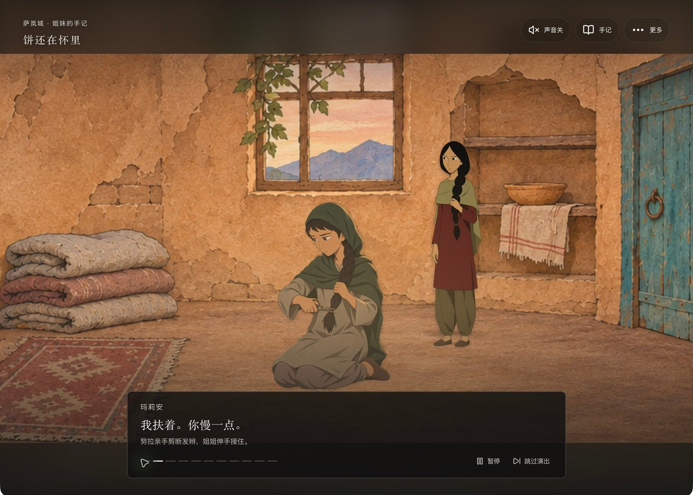

# 姐姐，我该怎么走

以《养家之人》的处境和种子童话为参考创作的中文互动叙事小游戏。

**0.7.1「今天先守住什么」**。父亲已被捕，粮袋只够盖住碗底。姐姐把剪刀放在你们之间，莱拉的字条从门下擦过。努拉可以留下分粮、剪发去市场挣一顿饭，或先赴水井边的约。进入故事就能做第一次选择，每局两次决定，走进一条完整的命运。



## 试玩与下载

- [网页试玩](https://xypasolini-droid.github.io/sister-which-way/) 使用浏览器本地存档。
- [0.7.1 小红书离线包及源码](https://github.com/xypasolini-droid/sister-which-way/releases/tag/v0.7.1)。
- [决策树](docs/design/STORY-FLOW.md)和[验收记录](docs/design/QA-v071.md)包含剧透。
- [0.6.0 历史发行版](https://github.com/xypasolini-droid/sister-which-way/releases/tag/v0.6.0)。

本机开发需要 Node.js 22.12 或更新版本。运行后打开 [游戏本地页](http://127.0.0.1:3000)。

```sh
git clone https://github.com/xypasolini-droid/sister-which-way.git
cd sister-which-way
npm ci
npm run dev
```

## 两个决定，六条命运

努拉自己动手剪发。玛莉安扶镜、收起发辫，并把亡兄的衣服递给她。留在家里的路线里，努拉也会分粮、列出可以求援的人家并亲手敲门。每项决定下的勇敢、智慧、善良描述这项行动。封锁、饥饿、婚事与征用来自她们面对的处境。

<details>
<summary>六个结局 · 含剧透</summary>

| 首次决定 | 第二次决定 | 终幕 |
| --- | --- | --- |
| 留下分粮 | 挡在门前，接着求援 | 01 门一直关着 |
| 留下分粮 | 请来人退开，让姐姐开口 | 02 粮袋旁少了她 |
| 去市场挣饼 | 拉住莱拉一起出城 | 03 两个被叫错的名字 |
| 去市场挣饼 | 逆人流回家接人 | 04 货斗里数四个人 |
| 去水井赴约 | 交还种子，走向梦中家人 | 05 春天没有叫醒她 |
| 去水井赴约 | 握住莱拉的手，睁开眼睛 | 06 一盏灯，许多只手 |

05 是梦境。06 是她醒来逃离后、多年间与其他女性一起建立互助院的原创未来。

</details>

## 演出与操作

背景、彩色透明人物、场景道具、光尘和前景分别绘制和合成。人物有随镜头更新的姿态、落脚点与遮挡关系。剪发、逆人流、受击、倒地、醒来和互助工作通过独立动作与换姿表现。货车后斗木栏位于人物前方。

| 操作 | 作用 |
| --- | --- |
| 点击选项，或按 1／2／3 | 单选并推进对应路线 |
| 暂停／继续 | 控制字幕推进和场景动画 |
| 下一句，或按 → | 手动推进对白和画面 |
| 现在做第 2 次选择／查看结局 | 直接到下一处选择或已经选定的终幕 |
| 观看开场／重看 | 播放完整开场或重播当前演出段 |
| 更多 → 回到上一个决定 | 撤回最近一次行动 |
| 手记 | 阅读来由、选择后果和历史收藏 |
| 开启声音 | 启用本地合成音效 |

每镜约六秒。对白按动作发生的顺序显示；梦中与现实的声音分别署名。后台暂停，刷新后按镜头恢复。0.7.0 的路线与结局收藏沿用 `r8`；只有旧版按序号保存的播放位置会回到当前段的安全起点。0.6.0 及更早的记录单独显示原标题、编号和正文。

## 电影参考与原创范围

电影供人物、衣着和场景动作参考。父亲在游戏中双腿完整、跛行，站立需木腋拐。梦中的少年苏莱曼、亡兄阿里与活着的幼弟萨米是三个人。04 使用露天货斗。05 与 06 保留现实家人的去向未知。

路线、对白与互助院是游戏创作。新美术参考已有手绘人物与局部缓存抽帧。实际检查时间点见[验收记录](docs/design/QA-v070.md)。仓库素材为本项目绘制的生成插画，无电影视频、音轨或原片截图。

## 技术与文件

Next.js App Router、React、TypeScript、CSS 分层舞台和 Vitest。主故事由本地确定性分支推进。小红书与网页试玩使用同一份静态构建。

| 文件 | 职责 |
| --- | --- |
| `src/lib/seven-ending-story.ts` | 四个分叉、九个行动、六个固定终幕 |
| `src/lib/seven-story-presentation.ts` | 镜头、字幕、时长和音效提示 |
| `src/lib/seven-story-scenes.ts` | 底图、人物、站位、动作与前景 |
| `src/components/LayeredStoryStage.tsx` | 独立层合成、运动和下一镜加载 |
| `src/components/SisterGame.tsx` | 选择、演出控制、手记和存档 |
| `src/lib/ending-collection.ts` | 结局收藏与历史版本隔离 |
| `src/minitool/` | 容器入口、存储与兼容方案 |

```sh
npm run typecheck
npm test
npm run build
```

## 小红书离线包

安装 [minitool-zip-builder 1.10.0](https://fe-static.xhscdn.com/minitool/20261105143522/minitool-zip-builder-1.10.0.skill)，读取其 `SKILL.md`。构建需 Python 3，可用 `MINITOOL_SKILL_DIR` 指定技能目录。

```sh
npm run build:minitool
npm run check:minitool
```

生成 `dist/姐姐，我该怎么走-小红书-0.7.1.zip` 和 `dist/minitool-audit.json`、`dist/minitool-audit.md`。素材收集遍历六条合法路线，纳入每个镜头实际使用的背景、人物、道具和前景。图片保持像素尺寸与透明通道，WebP 编码检查 PSNR。ZIP 采用 10,000,000 字节上限，入口是根目录 `index.html`。

2026-11-09 获取的[小红书在线规范](https://miniapp-sandbox.xiaohongshu.com/minitool/doc)与上版校验版本一致。发布的 ZIP 仍待创服模拟器、Android 真机扫码和 iOS 真机扫码验证。

## 历史与许可

历史故事与验收分别保存在[版本记录](REVISION_HISTORY.md)和[0.6.0 验收](docs/design/QA-v060.md)。第三方依赖遵循各自许可。项目尚未声明统一许可证。
