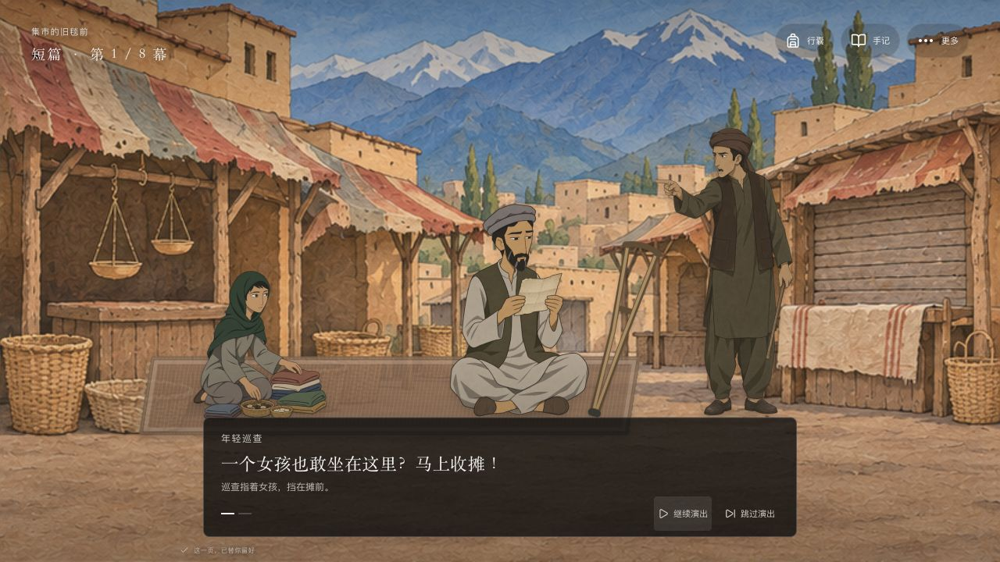
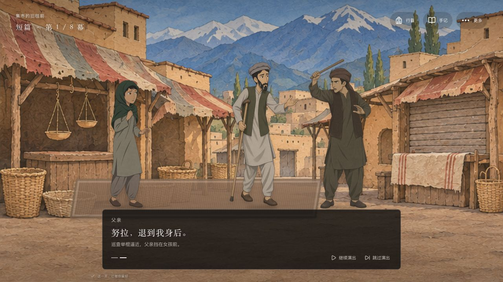
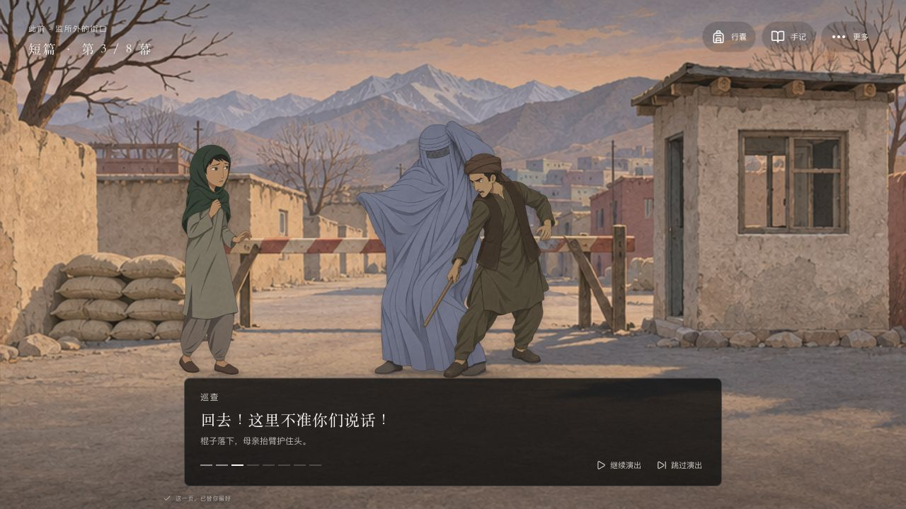
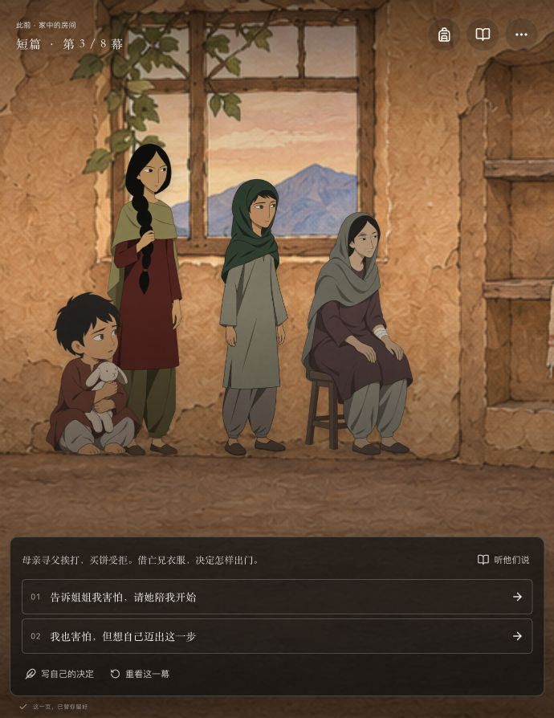
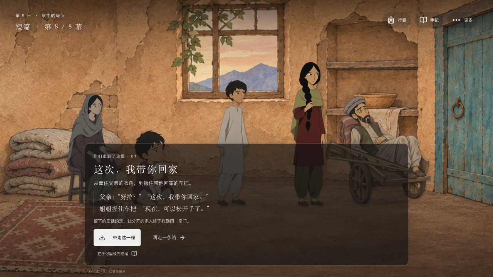
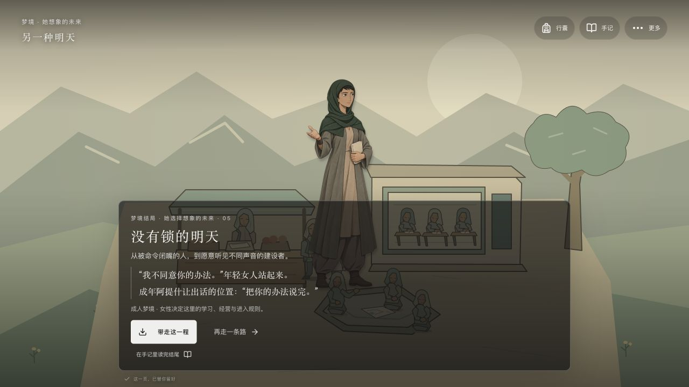

# 人物修正与父亲用拐连续性 · 0.4.1

## 修正依据

用户确认父亲双腿完整、走路有些跛，需要拐杖。旧版本依据局部裤管折叠和遮挡推断缺肢，是错误的制作依据，已撤回。五张错误父亲 SVG 及其生成逻辑已移除，避免旧脚本把错误重新带回游戏。

本轮重新查看本地影片的相关抽样：`00:02:10` 市场父女坐姿与摊边拐杖；`00:06:10–00:06:20` 市集对峙；`00:07:40–00:07:50` 用拐上阶；`00:13:20–00:15:30` 母女外出与受伤回家段；`01:23:18–01:23:20` 救后木推车。观看范围是相关段落与抽样，不声称重新逐帧审看全片，也不再以单帧作缺肢判断。每轮修改先核相关片源的要求已写进项目 `AGENTS.md`。

## 已接入的美术修正

- 运行时人物改回同一套细线、低饱和手绘 PNG。18 张新动作图使用原角色作参照，保持年龄、脸型与服饰。车辆和梦境背景继续使用现有 SVG，范围与人物替换分开。
- 父亲在摊前坐着读信，木拐在旁；起身护女、站立和被带走使用双腿完整的用拐姿态。获救后保留木手推车、车边收好的木拐与重伤休养，没有突然健步行走。
- 家中受伤后女主恢复自然站姿，移除原先不合比例的弯腰人形。她在街上受惊、扶母亲与男装蹲藏仍有不同姿态。
- 母亲街头姿态使用站立、护头与倒地三张同身份罩袍；旧坐凳图不再用于这些街头镜头。养伤坐凳图只留在家中。
- 年轻巡查、年长武装者、摊主、远亲和愿意帮助的阿明保持不同身份；同一巡查的三动作保持同一服装和脸。抓捕入口与后续抓人仍保留年轻举报者和武装者两人。

## 实际网页验收

使用独立 `localhost` 测试存档，不重置用户在 `127.0.0.1` 的第三幕进度。

| 场面 | 实际检查 |
| --- | --- |
| 开场两镜 | 父女确为坐摊；父亲双鞋可见，木拐在旁；下一镜父亲用拐站立，年轻巡查举棍 |
| 抓捕 | 父亲被带走仍为完整双腿、木拐；家人在场，母亲上前；最后空位保留 |
| 母亲遭打 | 公共罩袍保持面网，站姿无凳子；护头、棍落与倒地扶人分开呈现，人物不拉伸 |
| 受伤回家 | 女主不再是怪异驼背姿态；母亲在家坐着养伤，姐姐与幼弟在场 |
| 男装躲避 | 两女孩戴各自素帽，蹲姿坐低，未按实体包围盒放大；武装者仍可见 |
| 八幕团聚路径 | 从真实按钮单选推进 8 次到团聚结尾；父亲卧木推车，母亲伤势保留，无额外下一步确认 |
| 成年梦境 | 通过终章梦境按钮进入“没有锁的明天”，成年女主为手绘本子姿态，没有回退到儿童 |
| 用户正式页面 | 重启构建后的 `127.0.0.1:3001` 页面，仍在原第三幕；已显示自然女主造型，页面图片均完整加载 |

全部 18 张新 PNG 检查真实 alpha，清单在 `public/art/sister-v3/asset-manifest.json`。自动检查包含分支条件、五结局可达性、角色在场、实际资产存在及父亲文字连续性；解剖、服饰与动作位置依靠实际图像查看，测试不能替代美术验收。旧版 0.4.0 的 `oppression-*.jpg` 仅是历史记录，不能证明当前人物已经修正。

验证记录：16 个测试文件、165 项测试通过；TypeScript 与 Next.js 生产构建通过。图片加载回退按年龄、变装和公开／私密服饰选择；成年梦境与精确伤姿没有合适备选时隐藏失败图片，不凭空更换人物身份。
