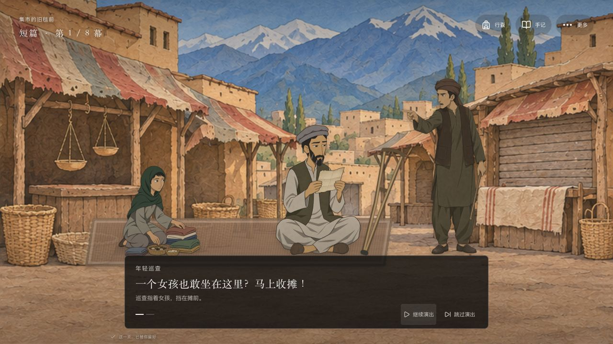
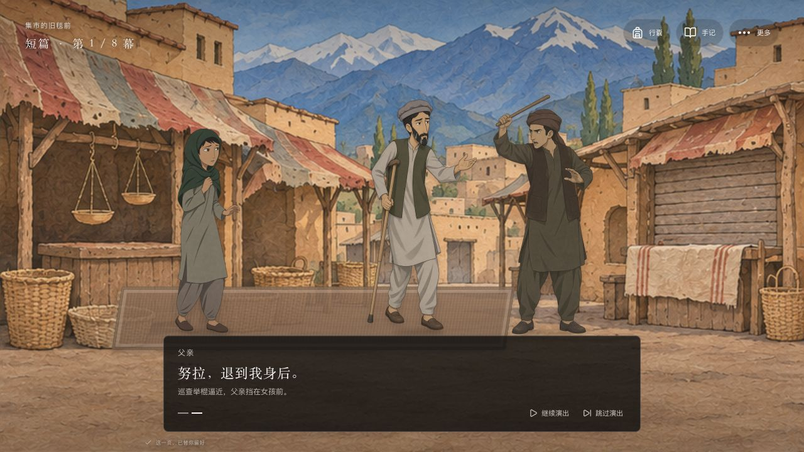
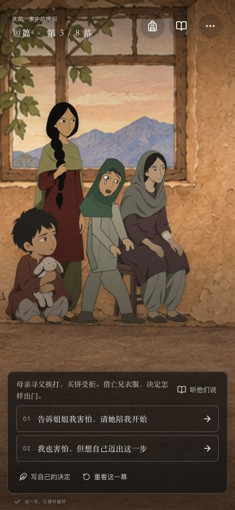
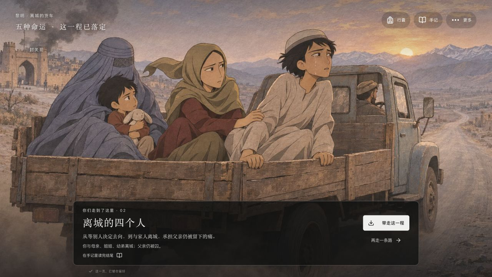
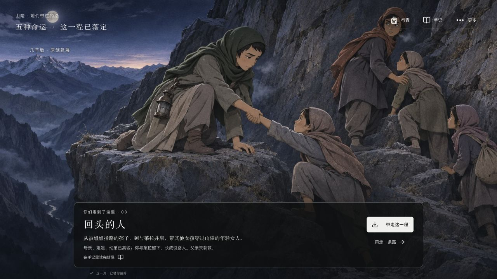

# 姐姐，我该怎么走

> 家里叫我努拉。走到街上，我叫阿提什——火焰。

一款以姐妹关系、家庭生计与寻找被捕父亲为主线的中文互动叙事小游戏。

十二岁的努拉和父亲坐在市场的旧毯上，替人读信，卖一点家中旧物。年轻武装巡查的报复把父亲从全家眼前带走。母亲要求放人，却在路上挨打；买食物的女孩也被拒绝和追赶。努拉剪下头发，穿上亡兄的衣服，与同样女扮男装的旧同学一起赚钱、打听消息，反复走近监所的门。

玩家通过单选决定怎样求生、照护家人、求助和兑现约定；每次选择都直接进入下一幕。姐姐会拒绝、争执、受伤、离开和重逢；故事的变化同时体现在人物、衣着、位置与场景里。

以 **Next.js + React + TypeScript + GSAP** 实现。默认是一局 **7 次关键决定的短篇**，对应 **5 种固定命运**；第七次选择后直接进入结局。其中 **3 种属于现实分支，2 种是明确标示的成年童话**。原 30 节点基础稿只承担旧版存档兼容。默认无需模型账户或 API Key。



## 开始运行

### 新电脑安装

需要 **Node.js 22.12 或更新版本、npm 和 Git**。Node.js 安装包通常包含 npm，可先用以下命令确认：

```sh
node --version
npm --version
git --version
```

克隆并安装锁定版本的依赖：

```sh
git clone https://github.com/xypasolini-droid/sister-which-way.git
cd sister-which-way
npm ci
npm run dev
```

在浏览器打开 **http://127.0.0.1:3000**。运行期间保留终端窗口，按 `Ctrl+C` 停止服务。首次安装依赖需要网络；默认剧情与美术随项目提供，游玩不需要调用外部模型。

如果下载的是仓库 ZIP，先解压，在含有 `package.json` 的目录打开终端，再执行 `npm ci` 和 `npm run dev`。

### macOS 快捷启动

完成一次 `npm ci` 后，可以双击仓库中的 **`启动游戏.command`**。这个脚本只启动本地服务，不会替你安装 Node.js、下载依赖或填写模型密钥。若系统未直接打开脚本，使用上面的终端命令即可。

### 端口与生产构建

若 3000 端口已被占用：

```sh
npm run dev -- --port 3001
```

然后打开 http://127.0.0.1:3001 。不同端口属于不同浏览器存储来源，不会共享当前进度。

本地检查生产构建：

```sh
npm run build
npm start
```

`npm start` 同样使用 127.0.0.1:3000。需要换端口时运行 `npm start -- --port 3001`。当前仓库提供本地运行方式，尚未提供公开在线试玩地址。

## 怎么玩

| 操作 | 用途 |
| --- | --- |
| 点当前行动，或选择路线、回应人物 | 单选即执行对应行动并推进剧情，无需整理物件、配衣服或做算术 |
| 分镜中的暂停／继续、跳过、重看 | 控制冲突演出；不会代选行动、改变物资或增加决定次数 |
| **听他们说**、继续、空格或右箭头 | 随时听短对白，没有倒计时或自动替选 |
| 点击行动；传统选择列表中也可按 `1`、`2`、`3` | 做出当前场景中的决定 |
| 传统选择列表中的 **先想一想** | 展开选项的完整说明与未满足条件 |
| **行囊** | 查看家人、物资、约定和最近发生的变化 |
| **手记** | 阅读完整场景与选择后果，回看童话、收藏结局，导出 Markdown |
| **更多 → 回到上一个决定** | 撤回到对应的剧情、人物和资源状态 |
| **静静看一会儿** | 暂时收起叙事界面，观看彩色场景 |
| **更多**中的显示设置 | 使用较大文字、减少画面运动或进入全屏 |

每场直接从现有行动中单选一条路，选下便推进。装包、整理衣物和算术小游戏已取消，也没有额外的“选择下一步”或最终确认层。赶摊、父亲被捕、母亲遭打、女孩被拒售并逼回家等冲突用短分镜自动呈现，可以暂停、跳过或重看；演出不会替玩家作决定。其他对白可随时打开，关键童话仍用 2–3 句切到独立画面，长篇正文与细节留在手记中。游戏已移除自由输入，所有关键行动均从当前选项中单选。

**短篇每局固定 7 次决定**：摆摊 → 被捕后的约定 → 变装 → 遇见莱拉 → 读信／作坊／姐妹交谈 → 选择北门、离城车或接应女孩 → 执行无法兼得的最后行动。第七次选择就结算，没有“写下结尾”“选择下一步”或最终任选梦境。父亲能否获救、女主是否与家人离城、是否折返接莱拉，都从已经执行的行动得出。

旧版完整篇的三十个节点是整张分支图，不是每局必须经历的三十步。旧版已完成路线保留并标为“旧版结局”；进行中的旧短篇先严格重放校验，再迁移仍然合法且含义未变的选择，必要时回到尚未作出新决定的分岔，不能把旧的“留下”视为同意与家人分别。重新开始会开启新版七次决定的短篇。新版短篇由已经做过的具体行动与联络约定决定后续路径，物资和伤势记录行为的代价，不以隐藏数值门槛锁住结局；当前短篇的结局行动不再依赖隐藏的早期经历解锁。可以重读、撤回或重新开始，不需要靠快速点击抢时间。

选择文案使用角色当下能完成的具体动作。救父路线会明确经历回家约定接应、数日读信教字与等候侧门的准备，代价是耽误日工并错过较早的离城机会。两个成年童话从接应女孩后的行动分出，均有可见路径；早期选择会改变经历与回应，不再作为需要猜测的隐藏钥匙。

演出只是表现当前处境，反复观看不能刷取资源。所有真实行动仍由 `choose` 检查当前节点、锁定条件、资源与后果，已经执行的剧情按存档恢复。当前视觉方向、分镜顺序和规则边界见 [单选分路与冲突分镜设计](../../docs/design/OPPRESSION-DESIGN.md)；实际试玩与未验证范围见 [可玩性验收](../../docs/design/PLAY-QA.md)。

## 画面里的变化

父女开场有专门的坐姿与摆摊动作。巡查走到摊前威胁，随后在家中带人抓住父亲、拖向门口，最后留下空位。短篇变装前，分镜依次呈现母亲被拦、求问、挨打、女孩扶她离开，再到摊主拒售、巡查举棍和女孩空手回家；地点会随事件改变。减少运动模式仍保留各拍姿态、字幕与在场事实。



服装与身体状态由剧情决定：女孩头巾、剪发后的小帽与男装、旅途行囊、姐姐在家与公开场合的不同衣着、母亲养伤、姐姐脚踝受伤，以及获救父亲重伤卧在木推车上，都有对应舞台状态。父亲遵守用户确认的游戏设定：**双腿完整、跛脚，行走需要拐杖**。旧版将他画成缺肢的判断已撤回，旧运行截图不能作为修正后造型的验收；局部片源复看和更正范围见[细节审计](../../docs/design/DETAIL-AUDIT.md)。主角、姐姐、母亲、父亲、幼弟萨米、同学莱拉与看守阿明按具体场面出现，不是每次转场都跟随同一支队伍。

现行巡查、摊主、远亲及受伤、扶人、害怕等动作姿态采用 `public/art/sister-v3/` 的手绘透明 PNG，参考原角色身份与服饰统一重绘。原有坐姿、养伤和推车角色继续使用 `sister-v2/`，过程中的车辆与旧版梦境背景留在 `oppression/`；新版五个终幕使用 `sister-v4/` 中五幅独立完整场景。旧几何人物稿已退出运行时，错误父亲 SVG 与对应生成逻辑已移除。它们不是电影帧裁切，也不声称逐帧复刻或获得真人历史学者认证。施压者通过具体身份与行动出现，不能将其泛化为整个伊斯兰文化的共同面貌。

人物使用持续保留的舞台槽位；普通切句和进入选择不会重播整组入场，也不会突然换人物大小。抓捕、换装和真正的进出场仍有实际变化。

彩色人物与纸片质感场景占据主画面，黑白半透明磨砂界面承载必要对白和操作。手机使用独立构图与纵向选项；说话人通过明暗突出，不把其他人物处理成透出背景的半透明剪影。

<p align="center">
  
</p>

## 现实、童话与梦境

现实层中的勇敢不会取消代价。男孩伪装为努拉打开有限的劳动空间，也会遇到被认出、剥削、武装胁迫和战争。母亲与姐姐不能因为换上外罩，就自由走过公开街道；司机、陌生人和一张纸也不能代替被要求的亲属陪同。

“火苗走过的路”是本作原创的连续童话。在照顾萨米、和莱拉续讲、监所等待等关键场景中，现实舞台会切到红金色纸片森林。故事给人安慰和想象，不会消除真实的伤势，也不直接决定父亲是否获救。

**0.5.0 将五个结局重写为五种固定命运。** 0.4.2 曾把多数路线归为“留城”，再换标题和文案；用户明确拒绝了这套处理。新版已删除第 03 类下面的课堂、分住、救父未成、借住等文案子类，也不再让所有路线最后随意挑两个梦境。

| 结局 | 女主与家人的去向 | 终幕中的实际行动 |
| --- | --- | --- |
| **01 这次，我带你回家** | 选择花数日准备接应与读信教字，最终在侧门接父亲。五个人重聚，错过离城车。 | 月夜里女主俯身推木车；父亲重伤卧车，姐姐接住另一边车把，母亲牵幼弟迎到门口。 |
| **02 离城的四个人** | 女主、母亲、姐姐、幼弟跟亲舅舅离城；父亲仍被囚，莱拉没有同车。 | 四人坐进露天货斗，女主扶栏离城，姐姐拉住她，母亲护着幼弟，城门在车后远去。 |
| **03 回头的人** | 女主先告别家人，再折返接被堵住的莱拉，错过封关。母亲、姐姐、幼弟离城，她与莱拉留下，重逢没有保证。 | **游戏原创的几年后**，两人成为秘密山路引路人。女主伏低身把女孩拉上石坎，莱拉接应同行者。 |
| **04 守护之地 · 成年童话** | 在接应路线挡到女孩身前，让莱拉先送她们进门；从这次行动续写成年愿望。现实家人已经离城，父亲仍被囚。 | 成年女主伸掌指挥全女性卫队展开防线，女孩从她们身后走向学校。 |
| **05 没有锁的明天 · 成年童话** | 先将受困女孩安顿进门，再陪她们写真名、讲自己的故事；续写成年女性共同建城之梦。现实中的分别没有被取消。 | 姐姐打开学校，莱拉开铺，成年女主把议事席让给提出异议的女人。 |

**同一辆离城车，是否回头救莱拉，会得到 02 与 03 两种不同命运。** 这不是换一句尾声：是否登车、姐姐是否在身边、女主是否留下以及数年后的角色都不同。莱拉的困境、封关的时限和车不能等的事实在选择前已说明，战争的代价不会到结算时才突然追加。

0.5.1 将救父所需的关系与约定放在明确的北门准备路线里：花几天反复读信、教字、确认接应，少接日工并错过较早的车，再等侧门出现机会。玩家不会因为开场没选隐藏钥匙而失去整个结局。最后仍要在接父亲、赶车、回头找莱拉之间承担代价。

两个成年童话从**已经选择留下接应女孩**的路线分出，三个行动都可执行。分别对应继续带路、站到女孩身前、安顿后陪她们写自己的名字，有明确的“成年童话”标记。梦不将现实中被囚的父亲、离城的家人或伤势改成无事发生。自治土地中的女性可以学习、经商、共同决定生活与进入规则。

五幅终幕在 `public/art/sister-v4/` 中各自拥有完整的地点、群像与动作；终幕不再叠加旧立绘。完整因果图见[故事流程图](../../docs/design/STORY-FLOW-v051-history.md)，实际检查范围见[五结局差异验收](../../docs/design/ENDING-DIFFERENCE-QA.md)。

下面两张是实际网页中到达02和03的截图。同样走到家人的离城车前，是否回头接莱拉，会改变在场家人、女主年龄、地点与最后的行动。





其余三种终幕及390×844手机截图也收录于[五结局差异验收](../../docs/design/ENDING-DIFFERENCE-QA.md)。

## 电影依据与原创范围

本作参考 **Nora Twomey 执导的 2017 年动画电影《养家之人 / The Breadwinner》**。它是原创分支游戏，不是电影授权改编或逐镜头复刻，也没有把小说中的情节自动当作电影内容。

| 层次 | 本项目如何使用 |
| --- | --- |
| 电影主干 | 父女摆摊、报复抓捕、母亲寻父遭打、女孩购食受拒、剪发穿亡兄衣服、同为男装的同学、反复探监、看守的个人冒险救援，以及母亲反抗强迫带离 |
| 电影中的具体因果 | 母亲主动写信提出姐姐的婚事，以求远亲照应；后来拒绝丢下尚未归家的女儿。取名“阿提什”的火焰含义也有课程材料依据 |
| 历史处境 | 核对 2001 年前后阿富汗的女性出行限制、衣着、私人诊疗和战争风险，限定到具体政权与时期，不概括整个伊斯兰世界 |
| 游戏原创 | 努拉、玛莉安等姓名与年龄、虚构山城萨岚、压缩的“第几日”、具体资源与数值、部分文书和名册支线、30 节点的分岔、火苗童话、三个现实结局及两个成年梦境 |

电影片尾保留开放性：父女与母亲、姐姐、幼弟分别艰难前行，朝着会合方向走去。游戏中的“这次，我带你回家”等明确团聚结果属于本作扩写，不声称电影已经演出了全家安全离境。

游戏里取得姓名、编号或文书的部分过程是原创支线，不应当作电影已有镜头或正常司法放人的程序；五日左右的章节时间也不是对影片真实时程的复刻。现实路线采用邻居明确邀请的一夜私宅借住与遮挡后的女医师诊疗，没有把制度性救济点当作剧情解答。

主要来源：

- [GKIDS 官方影片介绍](https://gkids.com/films/the-breadwinner/)：影片背景、女孩承担生计与故事主题。
- [CNC 官方教师资料入口](https://www.cnc.fr/cinema/education-a-l-image/college-au-cinema/dossiers-pedagogiques/dossiers-maitre/parvana-de-nora-twomey_1498891)及[同版教师册 PDF](https://mediatarn.org/wp-content/uploads/2023/07/dossier-enseignants-Parvana-de-Nora-Twomey.pdf)：人物关系、分场顺序、改编与 Aatish 的名字。
- [Le Pacte 官方 press kit](https://le-pacte.com/storage/uploads/edc4e180-ec46-4379-9268-d7c37c0a2c81/DP-web-PARVANA.pdf)：剧情简介、导演访谈与开放结局。
- [Human Rights Watch 2001 年报告，第 VI 节](https://www.hrw.org/reports/2001/afghan3/afgwrd1001-05.htm)：当时女性外出、服饰限制与暴力的访谈记录。

完整依据、局部影片观察、可确认内容和未核实部分分别见 [影片内容核查](../../docs/design/FILM-CONTENT-REVIEW.md)、[历史文化核查](../../docs/design/HISTORICAL-CULTURAL-REVIEW.md)、[本地影片抽样审计](../../docs/design/LOCAL-FILM-AUDIT.md)与[场景因果审计](../../docs/design/CAUSALITY-REVIEW.md)。这些是有来源的研究记录，不是逐帧看完整部电影或真人历史学者认证的声明。

## 存档与隐私

默认进度、结局册、对话位置和显示偏好保存在当前浏览器的 `localStorage` 中。当前首页没有账号系统、云端存档或多人同步。浏览器清理数据、更换浏览器、无痕窗口、切换域名或端口，都可能让你无法继续原来的进度。

- **重新开始**会开一局新故事，保留已见过的结局。
- **回到上一个决定**恢复对应的故事状态；结局册保存该结局最近一次到达时的实际家人状态。
- **导出 Markdown**得到可阅读的故事记录，目前不能把 Markdown 再导入为存档。
- 新版结局册单独使用 `sister-which-way.endings.r6` 与 `sister-which-way.ending-states.r6`。旧版收藏键保留，旧的同名ID不会计为新版命运已达成；主进度仍在原存档键，经过合法重放后恢复或迁移。
- 内部存档结构仍为 v3；`edition: short` 区分短篇，`storyRevision: 5` 标识五结局图，`storyContentRevision: 6` 标识本次重写的行动。验证先按原图重放，再对进行中的旧短篇迁移仍合法且含义一致的前缀；旧完成档保留并标作旧版，不会把旧路线当作新命运。旧 v2 记录不会被删除或强行解释成新结构。存档通过重放合法行动验证；只有曾停在旧 v3 抓捕入场处的快照有明确、有限的兼容处理。

### 小红书小工具版

小红书版本通过同一套剧情与界面代码生成独立离线 H5，入口是 ZIP 根目录的 `index.html`。小工具版优先使用平台 `xhs.miniTool.getStorage/setStorage` 保存进度；客户端能力不满足时才使用受保护的本地存储回退。写入失败会显示未保存，读取失败不会用空白档覆盖旧档。

小工具版不发起网页网络请求，不使用外部字体、模型服务、文件下载或浏览器全屏。手记导出显示为页内可选文本；游戏中的全部决定都是单选。窗口与安全区按当前公开 SDK 适配，旧端有 CSS 与 DOM 回退。

先将用户指定的[小红书打包skill 1.10.0](https://fe-static.xhscdn.com/minitool/20261105143522/minitool-zip-builder-1.10.0.skill)解压到项目的 `.codex/skills/minitool-zip-builder/` 并阅读其中 `SKILL.md`。构建需要 Python 3 执行其审计脚本；也可用 `MINITOOL_SKILL_DIR` 指向已安装的skill目录。然后执行：

```sh
npm run build:minitool
```

产物在 `dist/`：待上传 ZIP、`minitool-audit.json` 与 `minitool-audit.md`。五幅结尾 WebP 保持现有文件原字节，其他在用 PNG 转为原尺寸高质量 WebP，保留无损透明通道并自动核对尺寸、透明度与 RGB 误差；未使用的旧素材与电影不进入包。构建脚本会拒绝超过 10,000,000 字节的 ZIP。

静态检查通过后仍须将同一个 ZIP 上传创服平台，在平台模拟器、Android 真机扫码与 iOS 真机扫码分别验证。普通浏览器运行不能作为平台验收。详细规则与本轮结果见[小红书打包验收](../../docs/design/XIAOHONGSHU-PACKAGE-QA.md)。

## 技术与主要文件

当前首页使用 Next.js App Router、React、TypeScript 和 DOM 图层舞台；GSAP 负责克制的位移、换景与事件动画，Vitest 验证规则。AI 解释代码保留为旧原型历史模块，当前游戏界面不再调用。依赖中仍包含早期原型使用的 PixiJS，当前主舞台不依赖它绘制人物。

```text
src/app/page.tsx                    当前首页入口
src/components/SisterGame.tsx       对话、单选、存档、撤回、手记与结局册
src/components/NarrativeStage.tsx   常驻人物与物件、换景、四拍抓捕事件
src/components/SceneEncounter.tsx   直接单选故事路径与可选对白
src/components/OppressionSequence.tsx  冲突分镜及暂停、跳过与重看
src/components/narrative-stage.css  舞台比例、手机构图与减少运动
src/app/globals.css                 界面、磨砂面板、对话与弹窗样式
src/lib/branch-story.ts             完整篇规则、5 结局与按版本重放存档
src/lib/short-story.ts              默认短篇：7 次决定、前置条件与五种固定命运
src/lib/scene-encounter.ts          场景目标、短回应与合法行动映射
src/lib/play-flow.ts                阅读、场景操作、选择及结尾阶段
src/lib/scene-dialogue.ts           每场 2–4 句对白与入口条件
src/lib/story-presentation.ts       对话节拍、童话片段、简短结尾与称呼
src/lib/ending-content.ts           五种固定结局，不再按同一类别变换标题
src/lib/ending-presentation.ts      主屏成长主题与真实行动的结尾回声
src/lib/legacy-short-story.ts       旧短篇重放校验及迁移基线
src/lib/legacy-ending-content.ts    已完成旧版结局的历史保留
src/lib/narrative-stage-state.ts    具体在场人物、衣着、伤姿与场景映射
src/lib/decision-mode.ts            可选模型配置探测
src/app/api/decision/route.ts       服务端意图匹配，限制为当前已有选项
src/lib/*.test.ts                   路线、状态、存档、对白与舞台映射测试
src/components/NarrativeStage.test.ts  场景播报回归测试
public/art/sister/                  彩色背景与剧情道具
public/art/sister-v2/               人物变体、摆摊坐姿、童话与梦境素材
public/art/sister-v3/              统一手绘动作人物、父亲拐杖与生成提示词
public/art/oppression/             过程车辆、旧版梦境背景与历史人物稿
public/art/sister-v4/              五幅完整独立终幕、WebP与生成核查记录
docs/story/                        完整剧情、路线与设计说明
docs/design/                       研究、因果审计、设计与验收记录
docs/images/                       当前游戏界面截图
```

早期的 `src/lib/story.ts`、`StoryStage.tsx` 与 `/api/rewrite` 仍保留在源码中；当前首页使用上表的分支系统，旧原型并不是另一个默认游玩入口。

调整剧情时，建议同时检查节点正文、行动后果、短对白和舞台在场规则。新增一条边，除了“能走过去”，还应确认角色在下一场知道什么、谁真正到场、受伤是否仍需照护。

## 检查与验收范围

```sh
npm test
npm run typecheck
npm run build
```

测试涵盖新版七次决定的五结局可达性、同一撤离前缀的 02／03 反事实分岔、救父准备在当前路线完整执行、接应路线的三种不同成长、旧存档重放与迁移、历史输入匹配器、家人去向、伤势、场景播报与短对白。规则测试不能代替运行画面的实际检查。0.5.0短篇的历史画面证据见[五结局差异验收](../../docs/design/ENDING-DIFFERENCE-QA.md)；此前场景操作的历史验证见 [可玩性验收](../../docs/design/PLAY-QA.md)，使用的技能与 GitHub 工具依据见 [设计约定](../../docs/design/PLAY-DESIGN.md)与[改进记录](../../REVISION_HISTORY.md)。此前版本的测试数量、生产版完整路线与桌面／手机走查结果见 [发布前验收](../../docs/design/PUBLICATION-QA.md)；较早的界面改版记录见 [沉浸界面验收](../../docs/design/IMMERSION-QA.md)。

浏览器手机视口检查不等于所有实体手机、多浏览器和屏幕阅读器都已验证；小红书容器、旧 WebView 与实体设备须单独验证。这里不宣称已经人工走完全部 85 个行动或不存在任何问题。

开发内容可从 [故事设计](../../docs/story/STORY-DESIGN.md)、[完整剧情与路线示例](../../docs/story/STORY-CONTENT.md)、[场景因果审计](../../docs/design/CAUSALITY-REVIEW.md)开始阅读。

## 美术、素材与许可

人物、背景、剧情物件与梦境图是为本项目生成并整理的游戏插画，采用参考后的重新绘制，不是把电影帧裁切成游戏贴图。生成方式、提示词和素材说明见 [美术目录说明](../../public/art/README.md)、[背景与道具](../../public/art/sister/README.md)和[新版角色说明](../../public/art/sister-v2/README.md)。

用户提供的电影只在本机作为局部观看、抽样与研究参考。仓库不包含电影视频、电影音轨或电影截图；上方 README 图片是本游戏的运行截图。电影名称、角色及原作品的权利不因本项目的研究或再创作而转移，也不表示获得片方授权。

**目前没有为整个项目提供统一的 `LICENSE` 文件，也未将本项目声明为 MIT 授权。** 第三方依赖分别遵循其自身许可证；不能从依赖许可推断新增代码、文字或生成美术适用同一许可。需要复用或再发布时，请先确认相关部分的授权范围。

## 本轮流程与故事审查

已按七次决定、五种固定命运重新梳理[完整流程图](../../docs/design/STORY-FLOW-v051-history.md)，并参考此前的[游戏设计审查](../../docs/design/ENDING-GAME-DESIGN-REVIEW.md)、[小说结构审查](../../docs/design/ENDING-NOVELIST-REVIEW.md)及[影片细节审计](../../docs/design/DETAIL-AUDIT.md)。[导演与编剧的公开创作资料](../../docs/design/CREATOR-INFORMED-REVISION.md)用于本作原创调整，不表示创作者本人参与、授权或认可。
