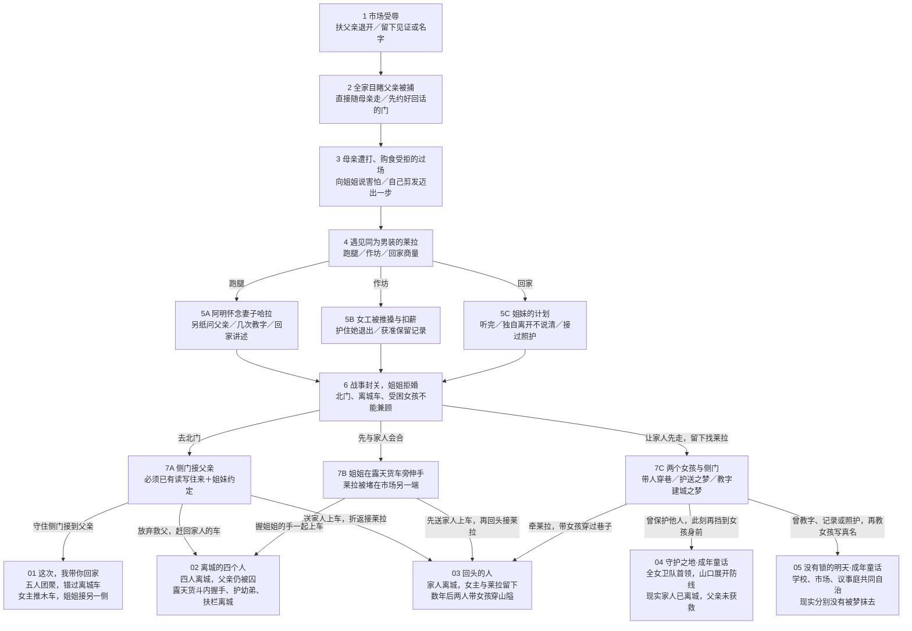

# 七次决定，五种固定命运

版本：0.5.0，`storyRevision: 5`。日期：2026-11-07。**完整剧透。**

现行规则取自 `short-story.ts`、`chooseWithHistory` 与 `getShortFate`。0.4.2 的“3 类现实＋2 个梦境、留城再换五种文案”方案已被用户拒绝，不再作为新版流程。原 30 节点数据和旧结局投影仅用于经过校验的旧存档，不能用来解释新版结局。

## 默认流程

每条新版路线恰好七次决定。第七步执行真实行动后，进入 `n30` **直接结算**，不再出现第八个“下一步”，也没有所有路线共用的终章梦境菜单。长后果和完整结尾在手记，主屏保留简短对话与画面。

## 小行为如何改变命运

| 行为 | 写入的具体事实 | 后续变化 |
| --- | --- | --- |
| 市场扶父亲退开；或护女工退出；或接过姐姐的照护 | `protectedSomeone` | 留下接应女孩后，可以把第二次保护续写为成年女性卫队之梦。母亲被打是共同遭遇，不能单独算玩家作过保护决定。 |
| 请熟客作见证、记名字；获准保留女工记录；反复教阿明认字；共同照护 | `recordPractice`／`literacyPractice`／`carePractice` | 留下后教女孩写名字，可以进入共同建城的成年童话。不是积攒隐藏希望值。 |
| 抓捕后先约好门与时限；或稍后听完姐姐、共同安排照护 | `pact` | 去北门时能按原约定接应。若之后独自离开不说去向，会移除约定；最后一刻补消息不能凭空恢复窗口。 |
| 反复为阿明读妻子哈拉的名字、教他自己认写 | `guardBond` | 阿明才有愿意冒险救人的关系基础。一次递父亲姓名只算相识，不能立刻换救援。 |
| 同一次撤离，选择登车 | `fateDeparture`、`boarded`、`familyTogether` | 02：女主与母亲、姐姐、幼弟同行。父亲没有回来，莱拉不在车上。 |
| 同一次撤离，说明不要等再折返接莱拉 | `fateGuide`、`familyDeparted`、`heroStayed`、`friendTogether` | 03：女主没有登车，与姐姐分离。两人共同求生，终幕时间跳跃成为引路人。 |

救父要求 `guardBond` **与** `pact` 同时存在。第六步北门行动没有新增 `pact`；临时托人找姐姐会耗掉侧门时段。失败条件在选项中解释，仍可选择赶车或折返救莱拉，不会锁死。默认短篇的结局不再由“其余全部算留城”兜底。

## 五个结局，各自只对应一种命运

| ID | 现实中父亲 | 现实中母亲、姐姐、幼弟 | 女主与莱拉 | 最终舞台 |
| --- | --- | --- | --- | --- |
| `reunited` | 阿明救出、重伤卧木车；双腿完整，旧跛行腋拐在车边 | 约定的门前与父女会合 | 女主推父亲，莱拉未被安排在门前 | 夜巷、木车、接住车把的一家五人 |
| `caravan` | 仍被囚 | 与女主乘优素福的露天货车离城 | 莱拉没有同车，未保证脱困 | 黎明货斗、栏板、远去的城门 |
| `lantern` | 未救出 | 已跟优素福离城 | 女主折返与莱拉留下，数年后共同引路 | 夜蓝山隘，拉女孩跨石坎、接应同行者 |
| `dream_guardian` | 现实仍被囚 | 现实已离城 | 现实与莱拉留城；成年卫队是明确童话 | 冷绿山口防线，成年女主发令、女孩通过 |
| `dream_commons` | 现实仍被囚 | 现实已离城 | 现实与莱拉留城；姐姐和莱拉的成年建城是梦中未来 | 暖金庭院，开校门、开铺、让出议事席 |

`lantern` 只是为兼容收藏而保留的内部 ID。它现在固定叫“回头的人”，没有课堂／独住／借宿等子类，也不随旗标换标题。两种童话拥有不同的成年角色职责和场面，但不会声称改写了现实家人的命运。

## 可重放的合法路线

下表是 `SHORT_ENDING_TEST_ROUTES` 中的行动 ID，适合自动回归；它们不是注入状态的作弊路径。

| 结局 | 七个行动 ID |
| --- | --- |
| 01 | `work → sew → buy → truth → courier → plan → release` |
| 02 | `work → sew → buy → pact → care → find → register` |
| 03 | `work → sew → buy → pact → care → find → child` |
| 04 | `work → sew → buy → pact → care → rush → father` |
| 05 | `neighbor → sew → buy → truth → courier → rush → school` |

02 与 03 的前六步完全相同，仅第七步由“上车”改为“回头接莱拉”，必须改变结局、女主是否登车、姐姐是否在身边与终幕场面。对应反事实是本轮的核心回归。

## 旧存档与历史材料

新版状态在既有 `version: 3` 结构上增加 `storyRevision: 5`，不用篡改历史来伪装升级。旧完成档经过原规则重放后，继续显示“旧版结局”；旧进行中短篇先校验再迁移已执行且含义未变的前缀，在行动语义改变的 n18 或作坊新保护行动前返回真实分岔。没有替用户接受新的分别，也没有把旧文案重命名成新03引路人生涯。

原 30 节点与完整篇文本保留为[历史基础稿](../story/STORY-CONTENT.md)，不是当前默认图。此前游戏设计、小说和创作者方法审查也属于历史依据；本版没有声称导演、编剧或真人历史学家亲自审稿。

本次实际影片核查范围与原创边界见[细节审计](DETAIL-AUDIT.md)，规则与运行画面的分别验收见[结局差异 QA](ENDING-DIFFERENCE-QA.md)。
