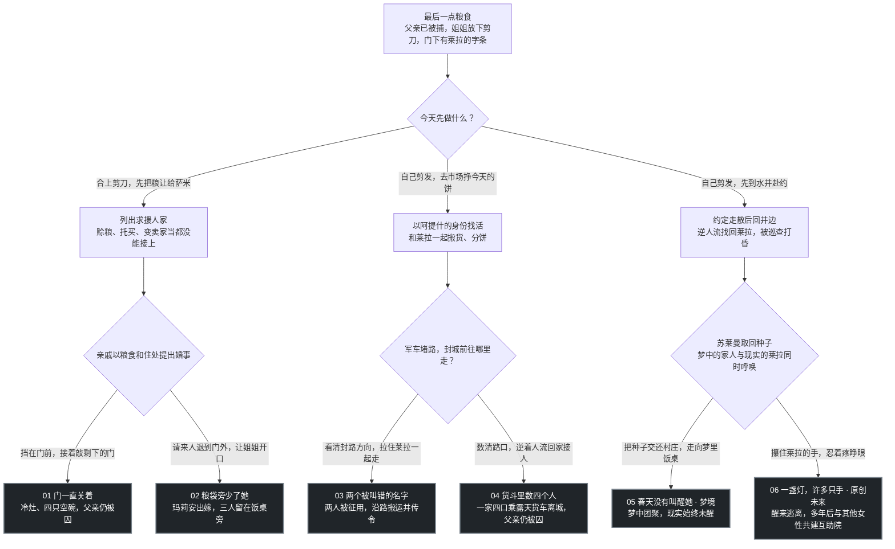

# 0.7.0 故事流程

每局两次决定。开场分别通往家门、市场和水井，三处后续分叉各有两个结局。勇敢、智慧、善良是行动描述。路线由选中的行动决定。

| 路线 | 首选 ID | 末选 ID | 结局 ID |
| --- | --- | --- | --- |
| 01 | `keep_bowl` | `close_door` | `doors_stay_closed` |
| 02 | `keep_bowl` | `let_sister_speak` | `grain_without_her` |
| 03 | `take_bread` | `hold_layla` | `two_borrowed_boys` |
| 04 | `take_bread` | `run_home` | `four_in_the_back` |
| 05 | `answer_note` | `follow_spring` | `spring_without_waking` |
| 06 | `answer_note` | `answer_layla` | `one_lantern_many_hands` |

[故事定义](../../src/lib/seven-ending-story.ts)维护行动、分支和因果，[镜头脚本](../../src/lib/seven-story-presentation.ts)维护自动演出，[舞台构图](../../src/lib/seven-story-scenes.ts)维护底图、站位与动作。旧版见 [0.6.0 故事流程](STORY-FLOW-v060-history.md)和 [0.6.0 可编辑决策树](decision-tree/决策树-v060.md)。
