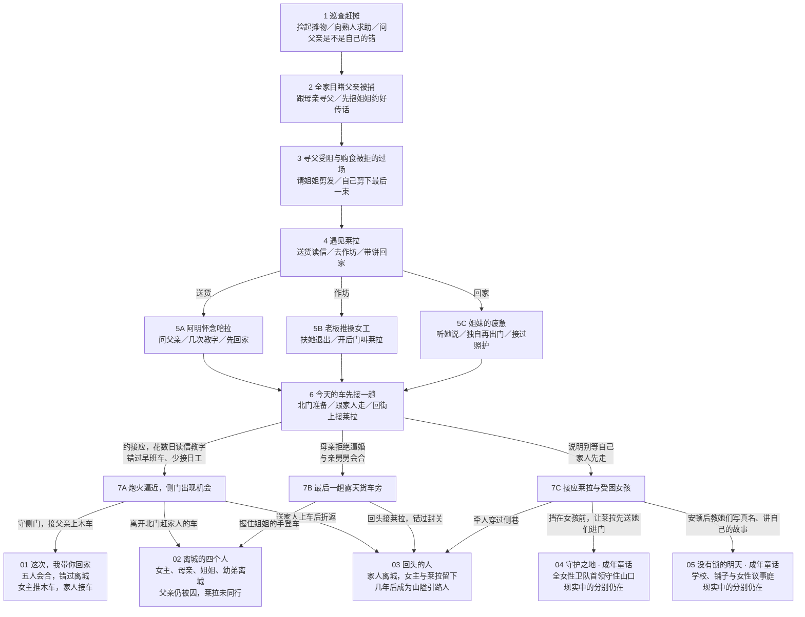

# 七次单选，五种不同命运

版本：0.5.1。规则标记：`storyRevision: 5`、`storyContentRevision: 6`。以下包含完整剧透。

主界面只用单选，第七次选择直接结算。没有自由输入、配衣物、算工钱或额外的“下一步”。前五幕建立关系与处境，第六幕明确选择承担哪条路的代价，第七幕执行最后行动。

## 选择怎样产生后果

救父所需的接应与信任不再藏在开场选项里。选择北门路线，会实际经历约好地点、几次读信教字、减少日工与延迟离城。若前面已有往来，叙述会承接已有关系；此前没有，也会在这条路线内完成过程。阿明保留妻子哈拉的信，父亲姓名写在另一张纸上，不能将怀念妻子的信当救父价码。

去接应女孩后，三个行动都可执行，分别通向引路人、成年卫队童话、成年自治童话。早期做过的照护、求助与教字会留在经历和人物回应中，不再充当需要猜测的结局钥匙。两种成年未来都标明是游戏原创童话，不能用梦消除现实的伤势与分别。

同一条撤离路线，在最后一刻选择上车或回头接莱拉，会直接改变女主是否离城、姐姐是否在身边和最后画面。选择保护朋友会失去与家人同行的机会；选择救父会失去最后一趟车。这些后果不能同时得到。

## 规则穷举

通过真实 `getChoices` 与 `choose` 穷举，共 **768 条合法完整路线、1210 个过程与终态组合**；每条均在第七次决定结算，没有中间无路可走的状态。

| 命运 | 完整路线条数 | 最终人物与动作 |
| --- | ---: | --- |
| 01 救父 | 96 | 女主推木车，重伤父亲卧车，姐姐、母亲与幼弟接应 |
| 02 离城 | 192 | 四人在露天货斗，父亲未同行 |
| 03 引路人 | 288 | 数年后女主与莱拉带女孩跨越山隘 |
| 04 守护童话 | 96 | 成年女主指挥全女性卫队，女孩走向学校 |
| 05 自治童话 | 96 | 成年女主让出议事席，姐姐开校门，莱拉经营铺子 |

这是选项图的路线计数，不是玩家到达概率；没有随机抽取结局。

五条可重放示例在 `src/lib/story-test-routes.ts` 的 `SHORT_ENDING_TEST_ROUTES`。测试还覆盖相同前六步、只改最后一次决定的 02／03 反事实，以及不依赖旧隐藏旗标的 01／04／05。

## 存档与历史版本

0.5.0 的五结局规则冻结在 `legacy-short-story-r5.ts`。旧快照先按原图严格认证全部状态，已经完成的结局保留原去向并标为旧版。进行中的旧五结局路线由于开场行动含义改变，会返回新开场，不能将旧动作解释为已同意新约定或已花数日做准备。原记录的完成结局不会被重新演算成别的命运。

新版收藏使用 r6 键，旧 r5 收藏保留，不计入新版 5/5。原 30 节点和更早版本也继续保留各自的旧图验证边界。影片局部复核范围见[细节审计](DETAIL-AUDIT.md)，当前验收见[结局差异记录](ENDING-DIFFERENCE-QA.md)。
