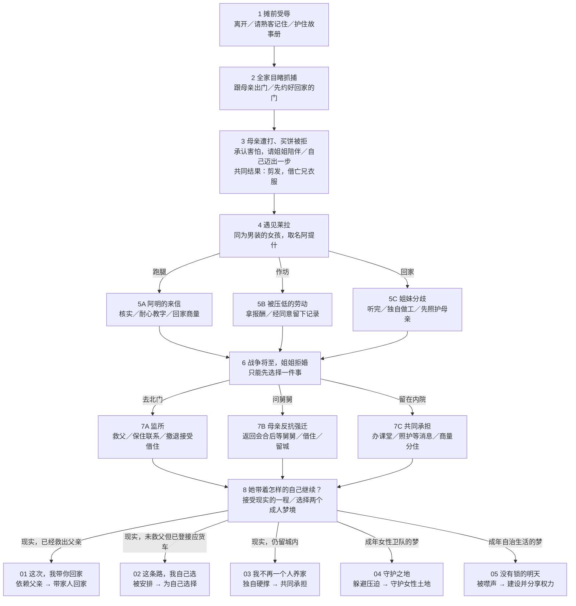
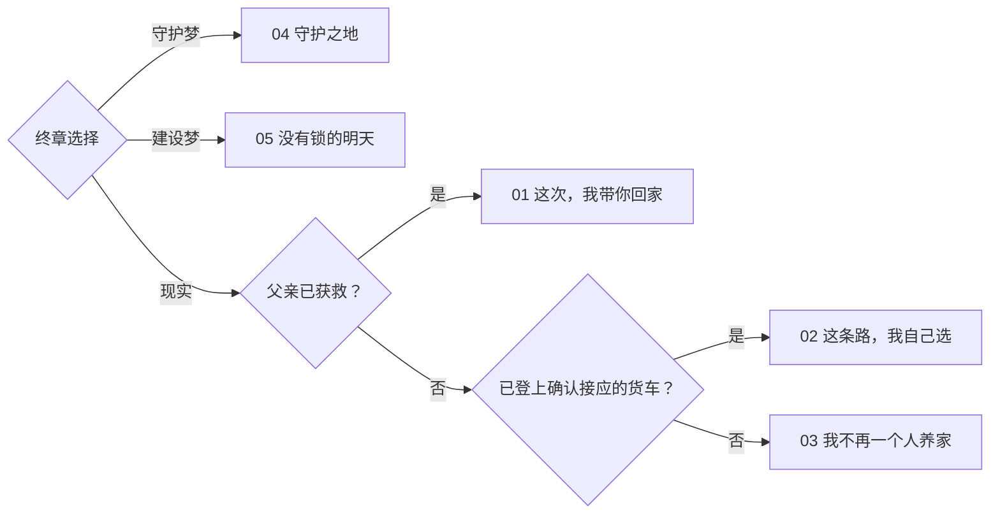
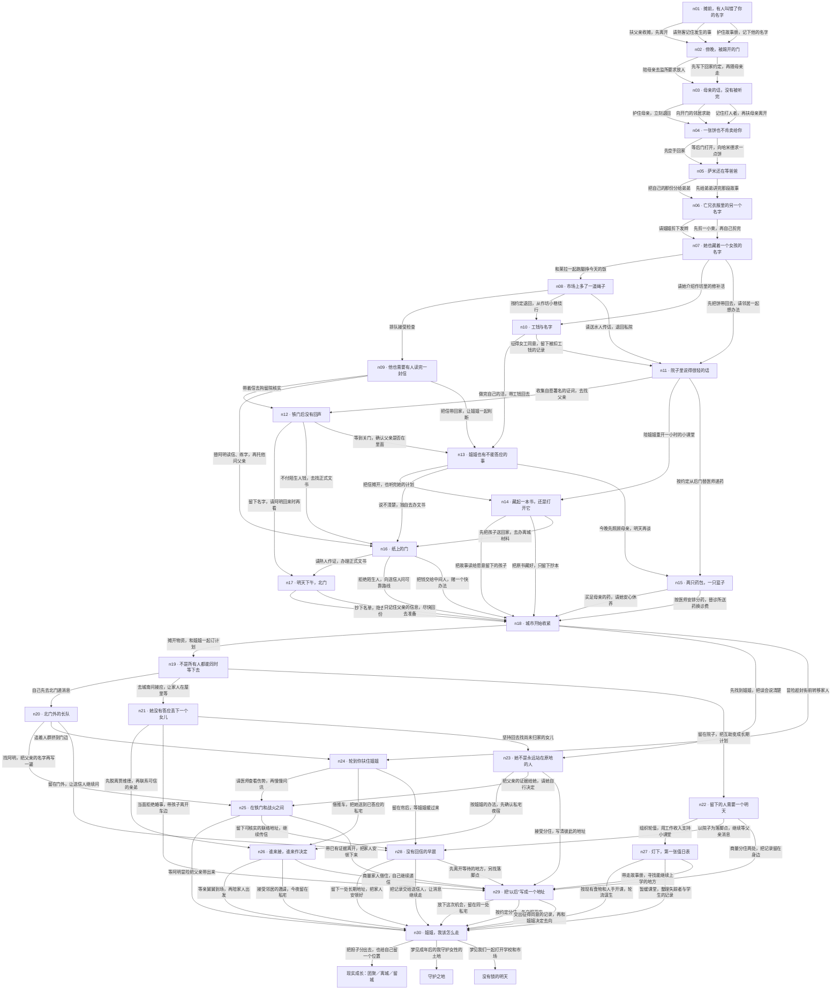

# 《姐姐，我该怎么走》流程图：八次决定，五种成长

版本：0.4.0。2026-11-07。以下是已实现规则，有完整剧透。图依据实际 `getChoices / choose / endingFor`，不是只改文案的设想。默认短篇八次决定；旧完整篇的30节点保留。

## 当前默认流程

## 小行为如何改变大走向

| 早先行为 | 后来的回声 | 改变与边界 |
| --- | --- | --- |
| 替阿明读信、耐心教字 | 北门认出字迹，才有冒险寻人的关系基础 | 救父有机会；仍需守住姐妹联络、避开被重点注意，不是买一张必救券 |
| 抓捕后先写下回家约定 | 女主去北门时，家人有可确认的回话门与时限 | 战乱中能够接上彼此；单有地址不能让武装者开门 |
| 听完姐姐，或承认需要帮忙 | 姐妹共同分工，女主也获得上课与休息的位置 | 成长不是永远独自供养全家；分住版本仍保留距离与未解争执 |
| 支持母亲与姐姐拒绝强迫婚事 | 亲舅舅接应与远亲的强迁明确分开 | 可以自主离开；父亲未获救，露天货斗并不等于到达安全世界 |
| 经同意保存别人的经历 | 留城尾声区分保留、建立联系与真实交出；女主继续共同谋生 | 不另算一个“写信结局”，也不许诺记录立刻推翻现实 |

## 五个结局的真实判定

写信、等待、分住、借住、课堂和见证保留为前情与尾声差异，不再是独立结局。终章当前只提供一个与真实处境相符的现实落点和两个梦境入口；已完成的团聚/离城不会被最后一个抽象动词覆盖。梦境明确为成年愿望，不改现实资源、伤势或救父结果。

## 30节点完整篇基础图

所有当前选项按 `NODES` 基础数据绘制。动态锁定仍由状态验证；短篇跳转按上图重写。旧存档历史中出现过的终章 `pages/wait` 只用于精确迁移，不再是当前可选动作。

## 审查与验证范围

自动穷举遍历 3466 个带历史状态，五结局均可达，每条合法短篇恰好八次决定；这不是玩家发生概率，也不是人工逐条试玩。

游戏设计与小说结构分别检查了行动回报、成长、伏笔和细节；这属于独立代理的角色化审查，不是外部真人专业认证。创作者方法依据公开资料推导，没有本人审稿或授权。

- [游戏设计审查](ENDING-GAME-DESIGN-REVIEW.md)
- [小说结构审查](ENDING-NOVELIST-REVIEW.md)
- [创作者资料与实际改稿](CREATOR-INFORMED-REVISION.md)
- [影片细节审计](DETAIL-AUDIT.md)
