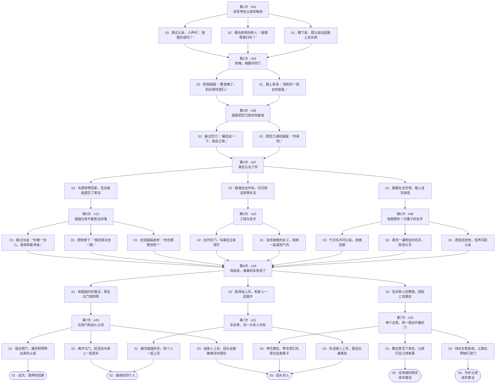

# 《姐姐，我该怎么走》可编辑决策树 · 0.5.1

这是当前代码的实际逻辑，不是新的剧情提案。仅整理设计文件，没有改变运行中的游戏。

## 4、5怎么选

前五次选择任意。第六次选「告诉家人别等我，回街上找莱拉」。第七次：

- 04「守护之地」：选「挡在女孩身前，让莱拉带她们进门」。
- 05「没有锁的明天」：选「教女孩写下真名，让她们自己讲故事」。

这一幕屏幕排列是：第一项→05、第二项→04、第三项→03；不要按结局编号猜位置。

## 怎样自己改

用 draw.io 打开同目录的 `.drawio` 文件。两页分别是「前五次选择」和「最后两次选择」；每个场景、选项、结局和连线都可编辑。双击改字、拖动布局，重接箭头改去向；修改后保存为新的 `.drawio` 文件。

只想调整剧情，可在下面的表格填写「你的新文案／新去向／触发条件」。ID只用于定位，保留它便于把改动落实到代码。图和表是设计文件，编辑它们不会自动改变游戏。

## 当前规则需要看清楚

- 第1、2、3次选择各自马上汇流；第4次分到读信／作坊／姐妹的第5幕，第5幕结束又全部回到n18。
- 前五次选择会改经历、数值、旗标和部分回应，但不会锁住或排除五个结局。最后两次选择实际决定命运。
- 96种前五次行动前缀都仍能到达五种结局。768是完整路线数，不是玩家概率。
- 当前没有隐藏数值门槛，也没有随机结局。你可以在表中增加前置条件、让某些路线不再汇流，或让早期小行为在后面产生回报／代价。
- 第六次跟家人走是今天的车；北门路线会等数日，只有北门第七幕才对应封关前最后一趟。
- 04、05是明确标记的成年童话；现实中家人已离城，父亲仍被囚，梦不会取消现实的分别。

## 完整决策图

## 逐项调整表

「选项序号」与对应场景的实际屏幕排列一致。

| 次数／场景 | 选项序号与ID | 当前文案 | 当前去向 | 你的新文案／新去向／触发条件 |
| --- | --- | --- | --- | --- |
| 1／n01 | 01 `work` | 蹲下来，帮父亲捡起摊上的东西 | n02 傍晚，被踢开的门 |  |
| 1／n01 | 02 `neighbor` | 看向卖饼的熟人：“能帮帮我们吗？” | n02 傍晚，被踢开的门 |  |
| 1／n01 | 03 `mother` | 靠近父亲，小声问：“是我的错吗？” | n02 傍晚，被踢开的门 |  |
| 2／n02 | 01 `cut` | 跟上母亲：“我和你一起去找爸爸。” | n06 姐姐把剪刀放在你面前 |  |
| 2／n02 | 02 `sew` | 抱抱姐姐：“要是晚了，别出来找我们。” | n06 姐姐把剪刀放在你面前 |  |
| 3／n06 | 01 `buy` | 把剪刀递给姐姐：“你来吧。” | n07 莱拉认出了你 |  |
| 3／n06 | 02 `help` | 接过剪刀：“最后这一下，我自己来。” | n07 莱拉认出了你 |  |
| 4／n07 | 01 `truth` | 跟莱拉去市场，替人送货读信 | n09 他想再听一次妻子的名字 |  |
| 4／n07 | 02 `hide` | 跟莱拉去作坊，问问有没有修补活 | n10 工钱与名字 |  |
| 4／n07 | 03 `pact` | 先把饼带回家，告诉姐姐遇见了莱拉 | n13 姐姐也有不能答应的事 |  |
| 5／n09 | 01 `verify` | 把信还给他，轻声问起父亲 | n18 母亲说，舅舅的车快到了 |  |
| 5／n09 | 02 `courier` | 再念一遍哈拉的名字，陪他认字 | n18 母亲说，舅舅的车快到了 |  |
| 5／n09 | 03 `sister` | 今天先不问父亲，收摊回家 | n18 母亲说，舅舅的车快到了 |  |
| 5／n10 | 01 `wage` | 扶住被推的女工，和她一起退到门外 | n18 母亲说，舅舅的车快到了 |  |
| 5／n10 | 02 `ledger` | 拉开后门，叫莱拉过来帮忙 | n18 母亲说，舅舅的车快到了 |  |
| 5／n13 | 01 `listen` | 坐到姐姐身旁：“你也很害怕吧？” | n18 母亲说，舅舅的车快到了 |  |
| 5／n13 | 02 `secret` | 把饼放下：“我还得出去一趟。” | n18 母亲说，舅舅的车快到了 |  |
| 5／n13 | 03 `care` | 接过水盆：“你歇一会儿，我来照看母亲。” | n18 母亲说，舅舅的车快到了 |  |
| 6／n18 | 01 `plan` | 和姐姐约好接应，再去北门找阿明 | n25 在铁门和战火之间 |  |
| 6／n18 | 02 `find` | 陪母亲上车，和家人一起离开 | n21 车在等，另一头有人叫你 |  |
| 6／n18 | 03 `rush` | 告诉家人别等我，回街上找莱拉 | n22 两个女孩，和一扇还开着的门 |  |
| 7／n21 | 01 `register` | 握住姐姐的手，四个人一起上车 | 02 离城的四个人 |  |
| 7／n21 | 02 `child` | 先送家人上车，我回头接莱拉 | 03 回头的人 |  |
| 7／n22 | 01 `school` | 教女孩写下真名，让她们自己讲故事 | 05 没有锁的明天 |  |
| 7／n22 | 02 `father` | 挡在女孩身前，让莱拉带她们进门 | 04 守护之地 |  |
| 7／n22 | 03 `send` | 牵住莱拉，带女孩们先穿过这条巷子 | 03 回头的人 |  |
| 7／n25 | 01 `release` | 留在侧门，接住阿明带出来的父亲 | 01 这次，我带你回家 |  |
| 7／n25 | 02 `letter` | 离开北门，赶回去与家人一起登车 | 02 离城的四个人 |  |
| 7／n25 | 03 `leave` | 送家人上车，回头去接被堵住的莱拉 | 03 回头的人 |  |

## 五个结局的成长与代价

| 结局 | 成长与最后画面 | 仍失去什么 | 你要改成 |
| --- | --- | --- | --- |
| 01 这次，我带你回家 | 你推着受伤的父亲穿过夜路。姐姐接住另一边车把，母亲与幼弟就在约好的门内。五个人重新聚齐。 | 父亲和阿明仍有重伤；你们错过离城的车，必须在战事中共同照护家人。 |  |
| 02 离城的四个人 | 你拉住姐姐的手，随母亲与萨米坐进亲舅舅的露天货斗。四个人越过关口，父亲留在铁门后。 | 父亲没有获救，莱拉也没有与你登上同一辆车。离开保住了四个人，没有把留下的人一并救走。 |  |
| 03 回头的人 | 你折返接住莱拉，错过家人的车。几年后的原创延展里，你们成为秘密山路上的引路人。 | 母亲、姐姐和幼弟已随舅舅离城；父亲未能救出。你与莱拉留下，重逢没有保证，接应他人也始终危险。 |  |
| 04 守护之地 | 成年童话：你成为全女性卫队的首领，守住女性自己决定生活的土地，让女孩从你身后走向学校。 | 现实中，母亲、姐姐与幼弟随舅舅离城，父亲未获救，你与莱拉仍留在城里；成年梦境没有改写这些事实。 |  |
| 05 没有锁的明天 | 成年童话：姐姐打开学校，莱拉经营铺子，你与女人们建立议事庭。女孩可以当街写下自己的真名。 | 现实中，母亲、姐姐与幼弟已离城，父亲仍被囚，你与莱拉留在城里；梦中的团聚与自由没有被当作已经发生的历史。 |  |

## 代码定位与复核

- 选项文案、短篇路由补丁：`src/lib/short-story.ts`，部分基础next继承自`src/lib/legacy-short-story.ts`。
- 实际推进与第七次自动结算：`src/lib/branch-story.ts` 的`getChoices/choose`。
- 结局文本与编号：`src/lib/ending-content.ts`。
- 原始快照：`decision-tree-v051.json`；来自真实`createInitialState → getChoices → choose`穷举，不靠猜测next字段。
- 本次核对：11个场景节点、29个选项、1210个过程与终态组合、768条完整路线，所有路线第七次直接结束。
- n30是内部收尾实现，当前短篇不向玩家显示额外的“下一步”，所以图中第七次直接连接结局。
